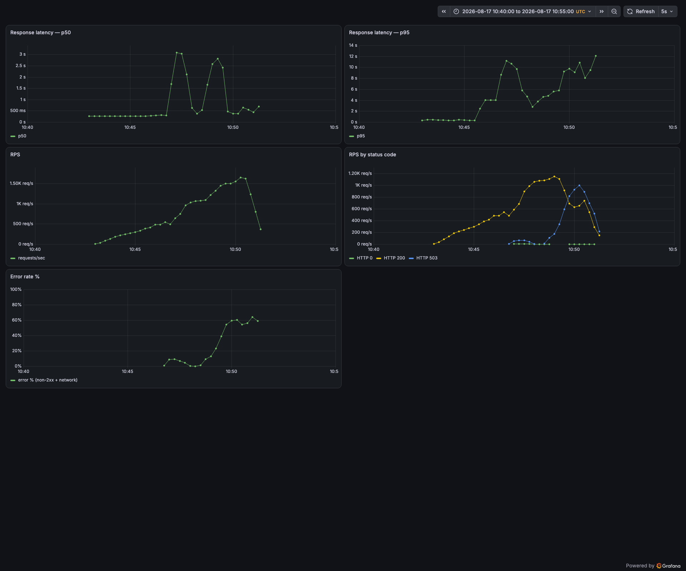
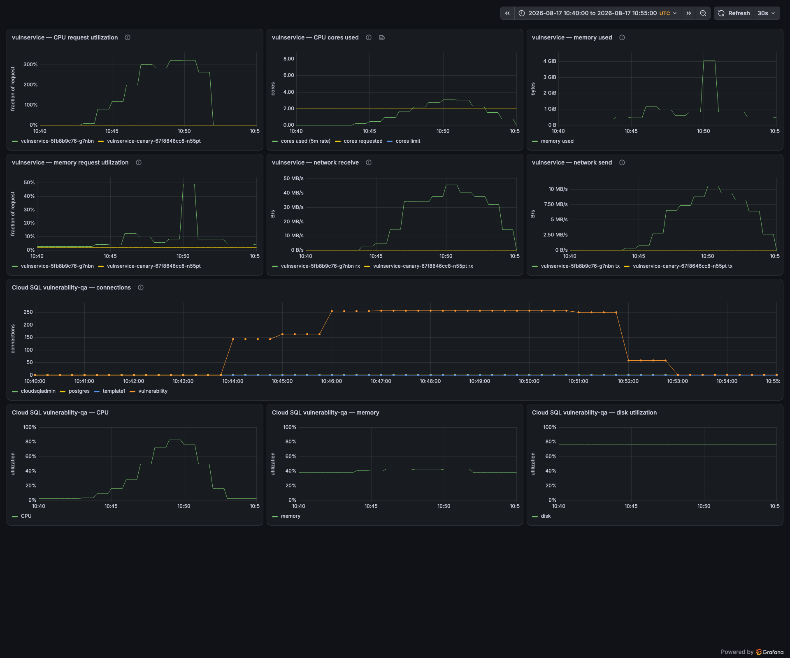

# package_info/cached load test — 2026-08-17 (6 vCPU)

**Endpoint:** `POST /vulnservice/api/v1/package_info/cached?skip_cache=true`  
**Command:** `SKIP_CACHE=true ./run.sh` · `PROFILE=full` (default; stages through **3000**)  
**Run window:** ~**10:43–10:51 UTC** (aborted ~07m34s into profile)  
**Env:** QA · 1× vulnservice primary (+ idle canary) · limits **4 CPU / 16 GiB** · Cloud SQL **`db-custom-6-32768`** (6 vCPU / 32 GiB, POSTGRES_17) · pool backends peak **~257**

> Earlier same day on **2 vCPU** ([analysis](../2026-08-17-package-info-cached-2vcpu/analysis.md)): cliff was **SQL CPU ~100%**. After scale-up to **6 vCPU**, SQL CPU has headroom (~**83%** peak) — the binding constraint moves back toward the **~256 connection pool**, with app CPU also high (~**80%** of 4-core limit).

## Dashboard snapshots





## Capacity

| | Value |
|--|------:|
| Max RPS applied (k6 target before abort) | climbing **1500 → 2000** (profile goes to 3000) |
| Peak delivered RPS | **~1.6–1.8k** |
| **2xx-only (0% 503)** | through **~500** (~498–600 delivered) |
| **Still mostly 2xx (healthy above 1k)** | **~1050–1200 2xx RPS** on the 1000 hold (~3–4% 503) |
| **First 503s** | ramp **500 → 1000** (first seen ~**11 503/s** while leaving 500) |
| **503 dominates** | target **~1500** (503 RPS climbs past 2xx; e.g. ~941 503 vs ~558 2xx) |
| Break / abort | under **~2000** target at **~25%** fail |

At abort: **25.0%** fail · **24.9%** 5xx (**all counted 5xx were `503`**) · **378,335** requests · ~**833** delivered RPS avg · max VUs **~5.6k** · **4312** interrupted · threshold abort (`http_req_failed` `rate<0.25`).

### Cliff cheat-sheet

| Question | Answer |
|----------|--------|
| Till what RPS are we clean 2xx? | **~500 RPS** (0% 503) |
| Till what RPS do we still clear mostly 2xx? | **Above 1k** — held **~1050–1200 2xx/s** |
| At what RPS do 503s start? | On the ramp **past 500 toward 1000** |
| At what RPS do 503s take over? | Around **1500** applied / ~1.5k delivered |
| After which RPS does latency spike? | Late **500** / ramp to **1000** — see below |

## Latency

| Band | Delivered RPS | p50 | p95 |
|------|--------------:|----:|----:|
| Stable | **~200–500** | **~270 ms** | **~340–640 ms** |
| First spike | late **~500** (VU explosion) | → **~830 ms** | → **~3–5 s** |
| Hard spike | ramp **→1000** (~800 delivered) | → **~3.5–4.3 s** | → **~12–14 s** |
| Recovered soft | **~1050–1100 2xx** (1000 hold) | **~330–530 ms** | **~1.2–3.5 s** |
| Collapse | **~1500+** | multi-second / noisy | → **~5–18 s** (success p95 up to **~23 s**) |

End-of-run (k6 summary, all stages): p50 **566 ms** (success-only **2.13 s**) · p95 **6.55 s** (success-only **7.47 s**) · max **30 s** (timeout).

**Read:** Latency first leaves the ~270 ms band at the end of the **500** stage. The big jump is on the ramp toward **1000** (p50 multi-second, p95 **~14 s**). On the **1000** hold it partially recovers while still serving **>1k 2xx/s**. Past **1500**, p95 stays multi-second and 503s dominate.

## Stage signals (Prometheus + GCP)

| Phase | Target | Delivered / 2xx | 503 | p50 → p95 | SQL backends | SQL CPU | Read |
|-------|-------:|----------------:|----:|----------:|-------------:|--------:|------|
| Hold | **200** | ~220 / ~220 | **0** | ~270 → ~350 ms | ~145 | ~9% | **Stable** |
| Hold | **300** | ~350 / ~350 | **0** | ~270 → ~350 ms | ~164 | ~16% | **Stable** |
| Hold | **500** | ~480–600 / same | **0** → first spike | ~270 → **~830 ms / 5 s** late | → **256** | ~28% | **Stable** → latency cliff |
| Ramp | → **1000** | ~800–1100 / mostly 2xx | **starts** (~11→100/s) | **~3–4 s → ~12–14 s** | **~257** | ~50→73% | 503 + latency spike |
| Hold | **1000** | **~1050–1200 2xx** | ~3–4% | ~330–530 ms → ~1–3.5 s | **~257** | → **83%** | **Healthy above 1k** |
| Ramp/hold | **1500** | 2xx collapses | **dominates** (~300→1200/s) | multi-s → **~5–23 s** | **~257** | **~83%** | **Broken** |
| Abort | → **2000** | ~1400–1800 mix | → **~25%** | noisy / timeouts | **~257** | ~76% | threshold abort |

### GCP DB (+ app) peaks

| Metric | Peak |
|--------|-----:|
| Cloud SQL tier | **`db-custom-6-32768`** (verified) |
| Cloud SQL CPU | **~83%** of 6 vCPU |
| Cloud SQL backends (`vulnerability`) | **~257** |
| Cloud SQL memory | ~**43%** |
| Pod CPU (primary) | ~**80%** of 4-core limit (~**3.2** cores) |
| Pod memory (primary) | ~**4.2 GiB / 16 GiB** (~24%) |

## RCA: why it breaks past ~1000→1500 RPS

### Real bottleneck: **DB connections / pool** (with SQL + app CPU as secondary pressure)

**Backends pegged at ~256 while SQL CPU still had headroom (~83% on 6 vCPU). Pool is the binding constraint again; 6 vCPU removed the earlier pure CPU cliff.**

| Signal at break | Observation | Meaning |
|-----------------|-------------|---------|
| Cloud SQL backends | **~257** (pegged from ~500 RPS onward) | **Primary bottleneck** — pool saturated |
| Cloud SQL CPU | **~83%** of 6 vCPU | Busy, **not** fully CPU-bound |
| Pod CPU | ~**3.2 / 4** (~80% limit) | Secondary pressure; not the first wall |
| Pod memory | ~**4.2 / 16 GiB** | Not memory-bound |

**Failure chain:**

```text
skip_cache bypasses Redis
  → every request hits Postgres heavily
  → app pool / backends peg ~256
  → in-flight work queues; VUs explode
  → SQL CPU rises (~83%) + pod CPU ~80% under backlog
  → latency / timeouts / context cancel
  → ~25% fail / ~25% 5xx → k6 abortOnFail
```

### Why this differs from earlier 2026-08-17 (2 vCPU)

| | 2 vCPU (early, ~05–06 UTC) | **6 vCPU (this run, ~10:43 UTC)** |
|--|----------------------------|-----------------------------------|
| SQL tier | `db-custom-2-8192` | **`db-custom-6-32768`** |
| SQL backends at cliff | **~256** | **~257** |
| SQL CPU at cliff | **~100%** | **~83%** |
| Real bottleneck | **DB CPU** | **DB connections / pool** |
| Clean 2xx (0% 503) | ~200–300 | **~200–500** |
| Still mostly 2xx | — | **~1050–1200 2xx/s** on 1000 hold |
| First 503s | ramp toward 500/1000 | ramp **500 → 1000** |
| End state | finished ~23% fail | **aborted** at ~25% fail toward 2k |

Scaling SQL **did** buy capacity (clean through **500**, still **>1k 2xx/s** on the 1000 hold). It did **not** remove the ~256 pool ceiling — backends peg from ~500 onward; 503s start on the ramp to 1000 and dominate around **1500**.

### Query Insights (GCP) — what burned the CPU

Window **10:42–10:52 UTC**. Source: Cloud Monitoring `…/insights/perquery/*` for `qa-setup:vulnerability-qa` ([console](https://console.cloud.google.com/sql/instances/vulnerability-qa/insights?project=qa-setup)).

| Rank | Share of query CPU | ~execs | mean latency | Query |
|-----:|-------------------:|-------:|-------------:|-------|
| 1 | **~58%** | ~275k | **~19 ms** | `clearly_defined_licenses` `DISTINCT ON (namespace, name)` via `unnest` |
| 2 | **~32%** | ~274k | **~10 ms** | `product_cves ⋈ cves` + `dense_rank()` provider priority (`ANY` …) |
| 3 | ~5% | ~277k | ~1.6 ms | `vulncheck_licenses` by ns/path/version |
| 4 | ~3% | ~275k | ~1.0 ms | `clearly_defined_licenses` exact `(ns,name,version)` |
| — | **≪1%** | ~284k | ≪1 ms | Full-table `vendor_aliases` / `product_aliases` (cheap; not the CPU story) |

**Read:** On 6 vCPU the ranking **flips** vs the 2-vCPU window — **CD DISTINCT ON (~58%)** leads; CVE ranking is still large (~32%) but faster (~10 ms mean vs ~134 ms on 2 vCPU). CD DISTINCT ON also leads **IO time**. Alias full scans remain negligible CPU.

### Amplifiers

1. **`skip_cache`** — full Postgres fan-out every request.
2. **Pool ~256** — pegged from the 500 stage through abort.
3. **`clearly_defined_licenses` DISTINCT ON** — top CPU (+ IO) consumer on this run.
4. **CVE `product_cves ⋈ cves` ranking** — second CPU consumer.
5. **Single primary pod** — all load on one app → one pool → one DB.
6. **`PROFILE=full`** — keeps climbing to 2k/3k after the cliff → guaranteed abort.

### Not the bottleneck

- **Cloud SQL CPU saturation** — peak ~83% on 6 vCPU (was the cliff on 2 vCPU).
- **Pod memory** — well under 16 GiB.
- **Redis** — bypassed by design.
- **Alias table scans** — high call count, tiny CPU share.

### Bottom line

Clean **2xx through ~500**. Latency first spikes late in that stage (p95 → **~5 s**), then hard on the ramp to **1000** (p50 → **~3–4 s**, p95 → **~14 s**). **503s start on that same 500→1000 ramp**; the **1000** hold still delivers **~1050–1200 2xx/s**. Around **1500**, 503s dominate and latency stays multi-second → abort under **2000**. Cause: **backends pegged at ~256**, not SQL CPU (peak ~83%). Next levers: **raise pool and/or cut CD DISTINCT ON + CVE ranking queries**.
