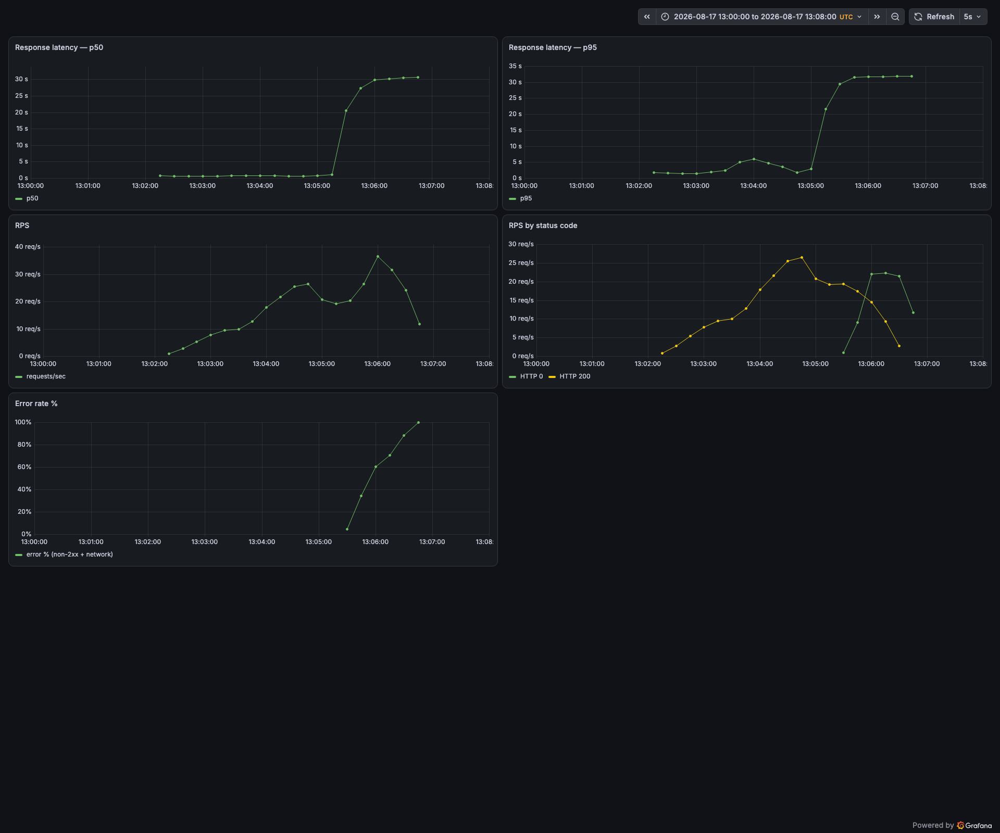
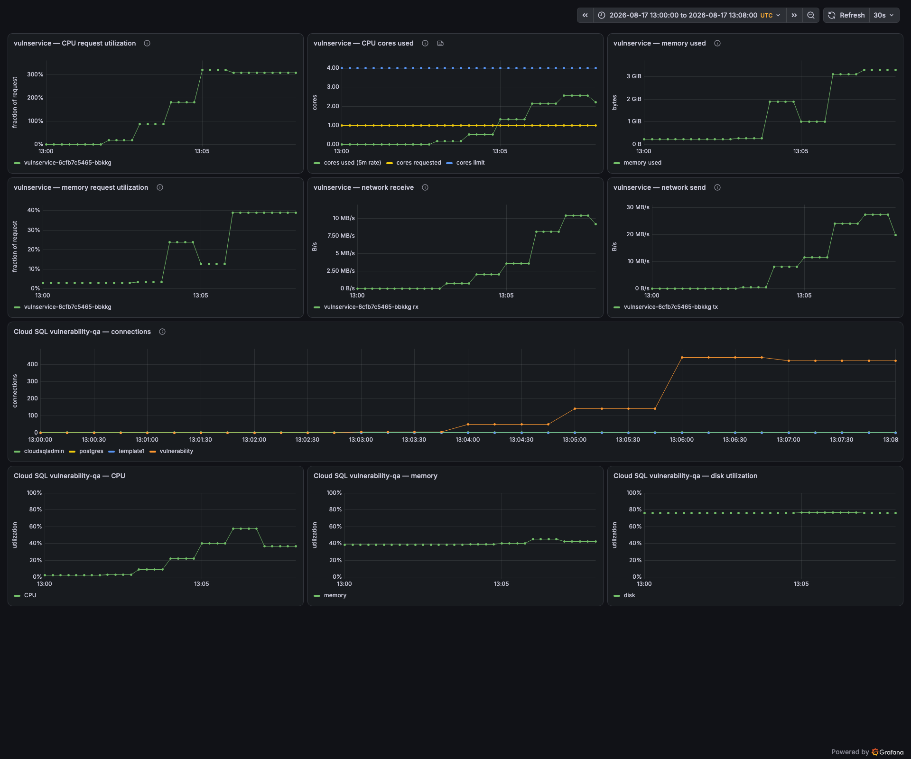
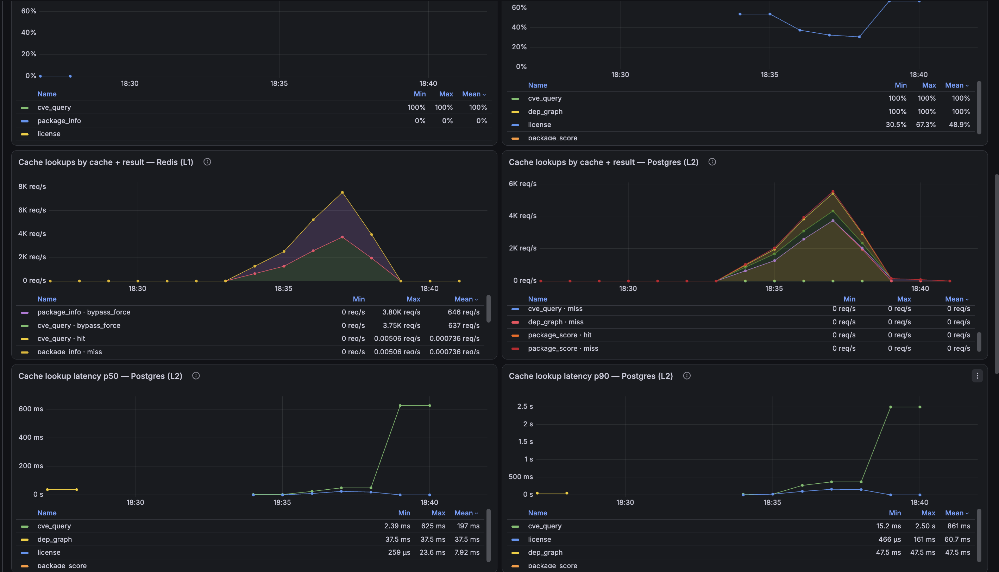

# package_info/cached load test — 2026-08-17 (batch 100)

**Endpoint:** `POST /vulnservice/api/v1/package_info/cached?skip_cache=true`  
**Command:** `PROFILE=batch100 ./run.sh` · **`batch_size=100`** · stages **10 → 25 → 50 → … → 500** (aborted early)  
**Run window:** ~**13:01:57–13:05:59 UTC** (aborted ~04m00s into profile)  
**Env:** QA · 1× vulnservice primary · limits **4 CPU / 16 GiB** · Cloud SQL **`db-custom-6-32768`** (6 vCPU / 32 GiB, POSTGRES_17) · **`POSTGRES_POOL_MAX_CONNS=512`** (verified) · backends peak **~441** (not pegged)

> Same day, same SQL/pool as [pool 512 · batch 1](../2026-08-17-package-info-cached-pool512/analysis.md). Only change under test: **100 PURLs per POST** + slower low-RPS profile.

## Dashboard snapshots







## Capacity

| | Value |
|--|------:|
| Max RPS applied (k6 target before abort) | climbing toward / holding **50** |
| Peak delivered RPS | **~40–50** (late; mostly timeouts) |
| **Clean 2xx (0% fail)** | through **~25** (~25–28 delivered) |
| **First timeouts (HTTP 0)** | early **50** hold @ **~13:05:30 UTC** |
| Break / abort | under **~50** target at **~25.7%** fail |

At abort: **25.72%** fail · **0.00%** 5xx · **4883** requests · ~**20** delivered RPS avg · max VUs **1500** · **1500** interrupted · threshold abort (`http_req_failed` `rate<0.25`).

### Cliff cheat-sheet

| Question | Answer |
|----------|--------|
| Till what RPS are we clean 2xx? | **~25 RPS** (0 timeouts / 0 5xx) |
| Till what RPS do we still clear mostly 2xx? | briefly into **50**, then collapses |
| At what RPS do failures start? | early **50** hold (**~13:05:30**) |
| Failure mode | **client 30s timeouts** only — **no 5xx/503** |
| PURL throughput at clean band | **~25 RPS × 100 ≈ 2500 PURLs/s** |

## Latency

| Band | Delivered RPS | p50 | p95 |
|------|--------------:|----:|----:|
| Stable | **~10** | **~0.67–0.82 s** | **~1.4–3.7 s** |
| Stable | **~25** | **~0.66–0.76 s** | **~1.3–2.1 s** (after ramp) |
| Cliff | early **~50** (**13:05:15+**) | → **~19–30 s** | → **~22–32 s** |

End-of-run (k6 summary): p50 **1.93 s** (success-only **849 ms**) · p95 **30 s** (success-only **27.8 s**) · max **30 s** (client timeout).

## When timeouts started (and why)

| Event | UTC | Elapsed | Stage | Signal | Root cause |
|-------|-----|--------:|-------|---------|------------|
| Clean hold | 13:03–13:04:45 | — | **10 → 25** | ~10 then ~25–28 2xx/s; p50 ~0.7 s | OK |
| VU explosion | **13:05:00** | ~3m | early **50** | VUs **60 → 585 → 1500**; backends **~140** | Each 100-PURL request slow → Little’s law blows VUs |
| **Latency cliff** | **13:05:15** | ~3m18s | **50** | p50 **~19 s**, p95 **~22 s** | In-flight queue; pool **not** pegged yet |
| **First client timeouts** | **13:05:30** | ~3m33s | **50** | HTTP **0** RPS appears; gap reqs−2xx climbs | p95 hits k6 **30s** timeout |
| Abort | **~13:05:59** | ~4m | **50** | fail **25.7%**; **0%** 5xx | threshold abort |

**Read:** Unlike batch-1 same-day runs, this cliff is **timeout-only**. Backends peak **~441 (<512)** and SQL CPU **~58%** — the pool never pegs. Failure is **per-request work for 100 PURLs** driving multi-second→30s latency and VU blow-up.

## Stage signals (Prometheus + GCP)

| Phase | Target | Delivered / 2xx | Fail mode | p50 → p95 | SQL backends | SQL CPU | Pod CPU | Read |
|-------|-------:|----------------:|-----------|----------:|-------------:|--------:|--------:|------|
| Hold | **10** | ~10 / ~10 | none | ~0.7 → ~1.5–3.7 s | ~6–49 | ~9–22% | ~0.9–1.8 | **Stable** |
| Hold | **25** | ~25–28 / ~25–28 | none | ~0.7 → ~1.3–2.1 s | ~49–140 | ~22–40% | ~1.8–3.2 | **Stable** |
| Hold | **50** | mix → timeouts | **HTTP 0** | **~19–30 → ~22–32 s** | → **~441** | → **~58%** | **~3.1–3.2** | **Broken** |
| Abort | **50** | — | **25.7%** fail, **0%** 5xx | p95 ≈ **30 s** | ~422 | ~37% | dropping | threshold abort |

### GCP DB (+ app) peaks

| Metric | Peak |
|--------|-----:|
| Cloud SQL tier | **`db-custom-6-32768`** (verified) |
| Cloud SQL CPU | **~58%** of 6 vCPU |
| Cloud SQL backends (`vulnerability`) | **~441** (max; **not** pegged at 512) |
| Cloud SQL memory | ~**45%** |
| Pod CPU (primary) | **~3.2 / 4** cores |
| Pod memory | **~3.1–3.3 GiB / 16 GiB** |
| Pool config | **`POSTGRES_POOL_MAX_CONNS=512`** (verified via pod env) |

## RCA: real bottleneck

### Primary: **`cve_query` Postgres latency under batch-100 → VU blow-up → 30s timeouts**

At the cliff, backends are **~140→441** (below 512), SQL CPU **~40–58%**, pod CPU **~3.2/4**. Decision tree does **not** say pool or SQL-CPU primary.

Harness Observability (same run window) shows the miss-path spike is concentrated in **`cve_query`**, not license:

| Postgres L2 lookup | During cliff | vs others |
|--------------------|-------------:|-----------|
| **`cve_query` p50** | → **~625 ms** max (mean ~197 ms) | license ~8 ms, dep_graph ~38 ms |
| **`cve_query` p90** | → **~2.5 s** max (mean ~861 ms) | license p90 only ~161 ms |
| Redis L1 | `package_info` + `cve_query` both **`bypass_force`** (~3.7k/s each at peak) | Redis not serving; expected with `skip_cache` |

So each HTTP request with **100 PURLs** pays many slow CVE Postgres lookups. Latency leaves the ~0.7 s band as soon as target hits **50**, VUs slam into the **1500** prealloc ceiling, and k6 records **timeouts** (not 503s).

| Signal at first timeouts (13:05:30) | Observation | Meaning |
|-------------------------------------|-------------|---------|
| App `cve_query` Postgres p90 | → **~2.5 s** | **Primary latency driver** on L2 miss path |
| Cloud SQL backends | **~140→441** (later) | Rising, **not** at 512 peg |
| Cloud SQL CPU | **~40–58%** | Headroom |
| Pod CPU | **~3.2 / 4** | High amplifier, not at limit first |
| 5xx / 503 | **0%** | Not the pool-exhaust 503 path |
| Client timeouts | **dominant fail mode** | Primary symptom |

**Failure chain:**

```text
skip_cache + batch_size=100
  → Redis L1 bypass_force on package_info + cve_query
  → every PURL hits Postgres; cve_query L2 p50→~625ms, p90→~2.5s
  → 100 PURLs/request × slow CVE lookups → multi-second HTTP latency
  → VUs explode (Little’s law) to hold arrival rate
  → in-flight queue → p50/p95 → 30s
  → client timeouts (HTTP 0); no 503 because pool never fully pegs
  → http_req_failed > 25% → k6 abortOnFail
```

### Query Insights (GCP) vs app latency

Window **13:01–13:07 UTC** ([console](https://console.cloud.google.com/sql/instances/vulnerability-qa/insights?project=qa-setup)):

| Rank | Share of query CPU | Query |
|-----:|-------------------:|-------|
| 1 | **~38%** | `clearly_defined_licenses` `DISTINCT ON (namespace, name)` via `unnest` |
| 2–5 (combined) | **~36%** | `product_cves ⋈ cves` + `dense_rank()` provider priority (several variants) |
| 3 | **~12%** | exact `clearly_defined_licenses` `(namespace, name, version)` via `unnest` |
| 6–7 | ~4–5% | other license point lookups (`vulncheck_licenses`, `api_dev_licenses`, …) |

**Read:** Insights ranks **total SQL CPU share** (CD DISTINCT ON still #1). App panels rank **per-lookup latency** — and there **`cve_query` is the spike** (license stays flat). Both matter: CD burns CPU budget; **CVE ranking is what stretched each request** into the timeout cliff under batch-100.

### Amplifiers

1. **`skip_cache`** — Redis `bypass_force`; full Postgres fan-out every PURL.
2. **`batch_size=100`** — 100× CVE/license work per HTTP request vs batch-1.
3. **`cve_query` Postgres L2 latency** — p90 → **~2.5 s** at cliff (app evidence).
4. **CD DISTINCT ON** — still top Insights CPU share (~38%).
5. **Pod CPU ~3.2/4** — secondary squeeze once backlog exists.
6. **Single primary pod** — one pool → one DB.
7. **k6 30s timeout** — turns multi-second queueing into hard fails.

### Not the bottleneck

- **DB pool peg at 512** — backends max **~441**.
- **Cloud SQL CPU saturation** — peak **~58%**.
- **5xx/503 path** — **0%** 5xx entire run.
- **Pod memory** — ~3 GiB / 16 GiB.
- **Redis** — bypassed by design (`bypass_force`).
- **License L2 latency** — stayed low (~8 ms p50) while CVE blew up.

## Comparison vs batch size 1

Comparator: same-day [pool 512 · batch 1](../2026-08-17-package-info-cached-pool512/analysis.md) (`PROFILE=full`, 1 PURL/POST, same `db-custom-6-32768` + pool **512**).

| | **Batch 1** (pool512, ~12:30 UTC) | **Batch 100** (this run, ~13:02 UTC) |
|--|-----------------------------------|--------------------------------------|
| SQL tier / pool | `db-custom-6-32768` / **512** | same |
| Profile | `full` (200→3000) | `batch100` (10→500) |
| Clean HTTP RPS (0% fail) | **~500** | **~25** |
| Clean **PURL/s** | **~500** (×1) | **~2500** (×100) |
| Soft / still useful | **~1100–1225** 2xx on 1000 hold | none past 25 before cliff |
| First failure | **503s** on ramp **500→1000** | **timeouts** on early **50** |
| 5xx at cliff | **yes** (~24% by abort) | **0%** |
| Backends at cliff | **512 pegged** | **~441** (not pegged) |
| SQL CPU peak | **~83.5%** | **~58%** |
| Pod CPU peak | **~3.5–3.9 / 4** | **~3.2 / 4** |
| Primary bottleneck | **DB connections / pool** | **`cve_query` Postgres latency → timeouts** |
| Abort | ~25% fail under ~2000 | ~25% fail under **~50** |

**Takeaways**

1. **Batching wins on PURL throughput in the healthy band** — ~**5×** more PURLs/s clean (~2500 vs ~500) while using **far fewer** DB backends at that point (~50 vs ~214 at batch-1’s 500 RPS).
2. **HTTP RPS ceiling collapses** — sustainable request rate drops from ~**500** to ~**25** because each call does 100× work.
3. **Failure mode flips** — batch-1 dies on **pool peg → 503**; batch-100 dies on **latency → 30s timeout** before the pool pegs.
4. Same SQL hot spots, but **different symptom**: Insights still shows CD + CVE CPU; app panels show **`cve_query` L2 p90 → ~2.5 s** as the request-time cliff under batch-100.

### Bottom line

**Healthy at ~25 RPS with 100 PURLs/POST (~2500 PURLs/s).** Breaks on the ramp/hold to **50 RPS** with **timeout-only** failures while pool backends stay **under 512**. App metrics pin the stretch to **`cve_query` Postgres L2** (p50 → ~625 ms, p90 → ~2.5 s); license stays flat. Versus batch-1 on the same env: **higher PURL throughput, much lower HTTP RPS, and a CVE-latency/timeout cliff instead of a 503/pool cliff.** Next lever: cut CVE ranking work per PURL (and CD DISTINCT ON for CPU share) — raising pool alone will not fix this shape.
