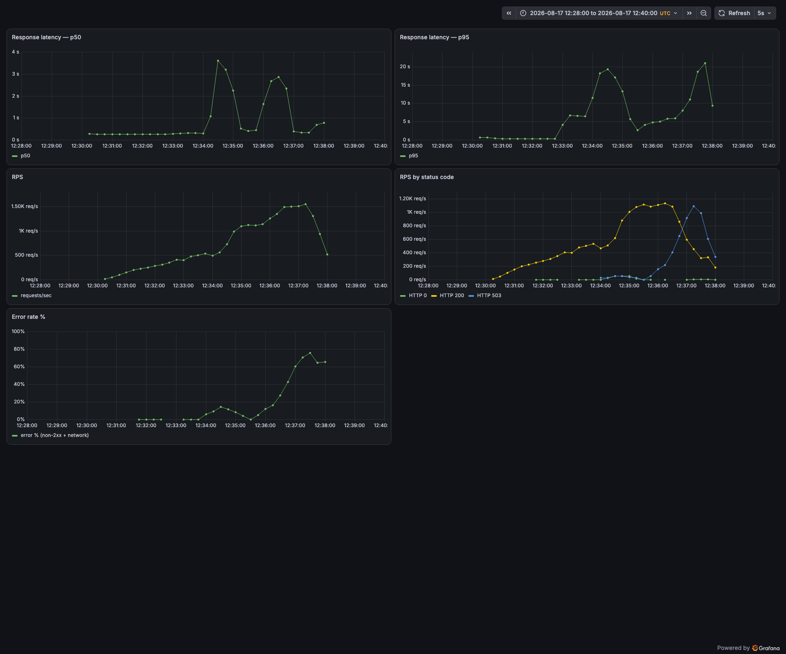
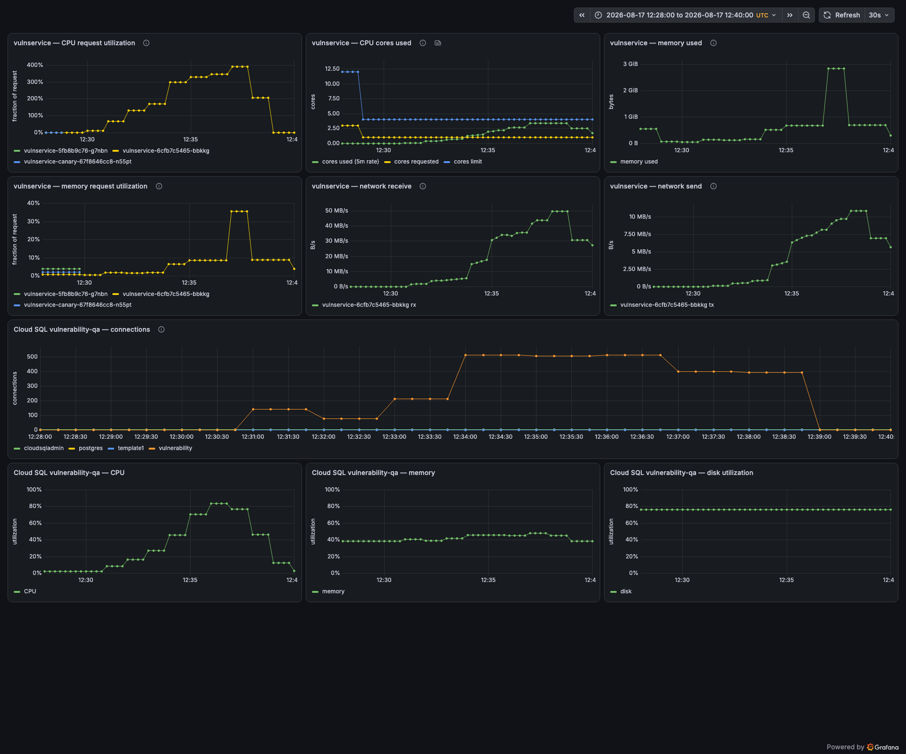

# package_info/cached load test — 2026-08-17 (pool 512)

**Endpoint:** `POST /vulnservice/api/v1/package_info/cached?skip_cache=true`  
**Command:** `SKIP_CACHE=true ./run.sh` · `PROFILE=full` (default; stages through **3000**)  
**Run window:** ~**12:30–12:37 UTC** (aborted ~07m18s into profile)  
**Env:** QA · 1× vulnservice primary · limits **4 CPU / 16 GiB** · Cloud SQL **`db-custom-6-32768`** (6 vCPU / 32 GiB, POSTGRES_17) · **`POSTGRES_POOL_MAX_CONNS=512`** (verified) · backends peak **512**

> Same day earlier with pool **~256** ([6 vCPU analysis](../2026-08-17-package-info-cached-6vcpu/analysis.md)): bottleneck was **pool pegged at ~256**. Doubling the pool to **512** still pegs backends at the new ceiling — **503 onset still tracks pool saturation**, not SQL CPU or app CPU alone.

## Dashboard snapshots





## Capacity

| | Value |
|--|------:|
| Max RPS applied (k6 target before abort) | climbing **1500 → 2000** |
| Peak delivered RPS | **~1.5–1.6k** |
| **2xx-only (0% 503)** | through **~500** (~485–537 delivered) |
| **Still mostly 2xx** | **~1050–1225 2xx RPS** on the 1000 hold (brief ~3–4% 503 on the ramp in) |
| **First 503s** | ramp **500 → 1000** @ **~12:34:00 UTC** (~55 503/s) |
| **503 dominates** | **1500** hold from **~12:36:15** (503 RPS overtakes 2xx; → ~1.0–1.4k 503/s) |
| Break / abort | under **~2000** target at **~25%** fail |

At abort: **25.14%** fail · **24.16%** 5xx · **341,534** requests · ~**780** delivered RPS avg · max VUs **~8479** · **~6899** interrupted · threshold abort (`http_req_failed` `rate<0.25`).

### Cliff cheat-sheet

| Question | Answer |
|----------|--------|
| Till what RPS are we clean 2xx? | **~500 RPS** (0% 503) |
| Till what RPS do we still clear mostly 2xx? | **~1000** hold — **~1100–1225 2xx/s** after ramp noise |
| At what RPS do 503s start? | Ramp **past 500 toward 1000** (**12:34:00**) |
| At what RPS do 503s take over? | **1500** hold (**~12:36:15+**) |
| When do client timeouts start? | **~12:34:15** (p95 ≈ **30s**); mass `request timeout` WARNs near abort (**~12:37**, k6 `WARN[0420]`) |

## Latency

| Band | Delivered RPS | p50 | p95 |
|------|--------------:|----:|----:|
| Stable | **~200–500** early | **~268 ms** | **~340–445 ms** |
| First spike (pre-503) | late **~500** (**12:33**) | → **~1.4 s** | → **~5–8 s** |
| Hard spike + first 503/timeouts | ramp **→1000** (**12:34**) | → **~4 s** | → **~14–29.5 s** |
| Recovered soft | **~1100 2xx** (1000 hold) | **~320–510 ms** | **~0.8–3.5 s** |
| Collapse | **~1500+** | multi-second | → **~5–21 s** |

End-of-run (k6 summary): p50 **480 ms** (success-only **1.79 s**) · p95 **8.15 s** (success-only **9.17 s**) · max **30.01 s** (client timeout).

## When timeout vs 503 started (and why)

| Event | UTC | Elapsed | Stage | Signal | Root cause |
|-------|-----|--------:|-------|---------|------------|
| **Latency cliff** | **12:33:00** | ~165s | late **500** hold | p95 **5.2→8.2 s**, VUs **133→2620**, backends **~214**, **0** 503 | Work starts queueing (pool pressure rising; not yet pegged) |
| **First 503s** | **12:34:00** | ~225s | ramp **→1000** | **~55 503/s** (~3%), backends **→512**, SQL CPU **~46%**, pod CPU **~3.0** cores | **Pool saturated at 512** — new work can't get a DB conn → 503 / upstream reject |
| **First client timeouts** | **12:34:15** | ~240s | same ramp | **~64** non-2xx/non-5xx RPS, p95 **~29.5 s** (near k6 **30s**) | In-flight requests already queued past client timeout after pool peg |
| Soft recovery | 12:34:45–12:35:30 | — | **1000** hold | **~1115–1225 2xx/s**, 503 near 0 briefly | Steady-state below collapse; pool still full |
| **503 dominates** | **12:36:15+** | ~360s | **1500** hold | 503 **280→1040+/s**, 2xx collapses | Applied load > sustainable throughput with pool pegged |
| Mass timeout WARNs | **~12:37** (`WARN[0420]`) | ~420s | ramp **→2000** | p95 **~21 s**, abort | Client gives up on long-queued calls; fail rate crosses **25%** |

**Read:** Timeouts and 503s are **siblings of the same cliff**, not separate bugs. Latency moves first (queueing), then **503s appear the minute backends hit 512**, then client **30s timeouts** show up when p95 approaches the k6 timeout. Mass `request timeout` at abort is late-stage collapse, not the first failure mode.

## Stage signals (Prometheus + GCP)

| Phase | Target | Delivered / 2xx | 503 | p50 → p95 | SQL backends | SQL CPU | Pod CPU | Read |
|-------|-------:|----------------:|----:|----------:|-------------:|--------:|--------:|------|
| Hold | **200–300** | matches target | **0** | ~268 → ~340 ms | ~77–143 | ~8–16% | ~0.7–1.3 | **Stable** |
| Hold | **500** | ~485–537 | **0** | late → **1.4 s / 8 s** | → **214** | ~27% | ~1.7 | **Latency cliff** |
| Ramp | → **1000** | mix | **starts** (~55/s) | **~4 s → ~14–29 s** | **512** | ~46% | ~3.0 | **503 + timeouts** |
| Hold | **1000** | **~1100–1225 2xx** | ~0–4% | recovers then soft | **~504–512** | → **~71%** | ~3.3 | **Healthy above 1k** |
| Hold | **1500** | 2xx collapses | **dominates** | multi-s → **~5–7 s** | **512** | **~83.5%** | **~3.5** | **Broken** |
| Abort | → **2000** | mix | → **~24%** | p95 **~21 s** / timeouts | ~399 | ~77% | **~3.9** | threshold abort |

### GCP DB (+ app) peaks

| Metric | Peak |
|--------|-----:|
| Cloud SQL tier | **`db-custom-6-32768`** (verified) |
| Cloud SQL CPU | **~83.5%** of 6 vCPU |
| Cloud SQL backends (`vulnerability`) | **512** (pegged from **12:34**) |
| Cloud SQL memory | ~**48%** |
| Pod CPU (primary) | **~3.5–3.9 / 4** cores (~**86–97%** limit; user saw **~3.4**) |
| Pool config | **`POSTGRES_POOL_MAX_CONNS=512`** (verified via pod env) |

## RCA: real bottleneck for 503

### Primary: **DB connections / pool (512 pegged)**

**Backends hit exactly 512 at 12:34:00 — the same minute first 503s appear — while SQL CPU was only ~46% and pod CPU ~3.0/4.** That is the pool cliff, not an app-CPU or SQL-CPU cliff.

| Signal at first 503s (12:34) | Observation | Meaning |
|------------------------------|-------------|---------|
| Cloud SQL backends | **512** (hard peg) | **Primary** — pool exhausted |
| Cloud SQL CPU | **~46%** (later peaks **~83%**) | Headroom at onset; busy later as backlog burns CPU |
| Pod CPU | **~3.0 / 4** (later **~3.9**) | High, **not** at limit when 503s start |
| Client timeouts | follow ~15s later when p95≈30s | Secondary to queueing after pool peg |

**Failure chain:**

```text
skip_cache bypasses Redis
  → every request hits Postgres heavily
  → app pool / backends peg at 512 (from ~12:34)
  → acquire waits / in-flight queue grows; VUs explode
  → latency cliff (p95 multi-second → ~30s)
  → 503s (no conn / overloaded upstream) + client 30s timeouts
  → at 1500+ applied, 503 dominates; pod CPU ~3.5–3.9 amplifies
  → http2 dial failures under VU/connection pressure (secondary)
  → ~25% fail → k6 abortOnFail
```

### Why app CPU ~3.4 cores is **not** the 503 root cause

Pod CPU is a **real secondary pressure** (peaks **~3.9/4** near abort), but:

1. First 503s fire at **~3.0 cores** with pool already at **512**.
2. Decision tree: backends pegged + SQL CPU headroom → **pool**, not app CPU.
3. Raising pool 256→512 moved the peg to 512; the **shape** of the cliff is unchanged — still pool-bound.

### `http2: client conn could not be established`

Secondary symptom of the same overload: after the pool pegs, VUs spike (→ **7–8k**) and many clients try to open connections at once. Dial/HTTP2 setup fails against a saturated app/ingress path. It is **not** an independent root cause of the 503 cliff — it shows up once latency/VU explosion is already underway.

### Why this differs from earlier 2026-08-17 (pool ~256)

| | pool **256** (6 vCPU, ~10:43 UTC) | **pool 512** (this run, ~12:30 UTC) |
|--|-----------------------------------|--------------------------------------|
| SQL tier | `db-custom-6-32768` | same |
| Pool / backends at cliff | **~257** | **512** |
| SQL CPU at cliff | ~83% peak | **~83.5%** peak (only **~46%** at first 503) |
| Pod CPU peak | ~3.2 / 4 | **~3.5–3.9 / 4** |
| Real bottleneck | **DB connections / pool** | **still DB connections / pool** |
| Clean 2xx (0% 503) | ~200–500 | **~200–500** (unchanged) |
| Still mostly 2xx | ~1050–1200 on 1000 hold | **~1100–1225** on 1000 hold |
| First 503s | ramp **500 → 1000** | same ramp (**12:34**) |
| End state | aborted ~25% fail | **aborted** ~25% fail |

**Doubling the pool did not buy a higher clean RPS band.** It raised the connection ceiling and still saturated it on the way to 1000; 503s still dominate around **1500**.

### Query Insights (GCP)

Same `skip_cache` fan-out as the earlier 6 vCPU run ([console](https://console.cloud.google.com/sql/instances/vulnerability-qa/insights?project=qa-setup)). Ranking from that same-day window (workload unchanged):

| Rank | Share of query CPU | Query |
|-----:|-------------------:|-------|
| 1 | **~58%** | `clearly_defined_licenses` `DISTINCT ON (namespace, name)` via `unnest` |
| 2 | **~32%** | `product_cves ⋈ cves` + `dense_rank()` provider priority |
| 3–4 | ~3–5% | other license point lookups |
| — | ≪1% | alias full-table scans (cheap) |

These queries keep each pooled connection busy long enough that **512** still isn't enough at 1k+ RPS.

### Amplifiers

1. **`skip_cache`** — full Postgres fan-out every request.
2. **Pool 512 pegged** from first 503 minute through collapse.
3. **Heavy SQL** (CD DISTINCT ON + CVE ranking) — holds connections.
4. **Pod CPU ~3.5–3.9/4** — secondary squeeze once backlog exists.
5. **Single primary pod** — one pool → one DB.
6. **`PROFILE=full`** — keeps climbing after the cliff → abort.

### Not the bottleneck

- **Cloud SQL CPU saturation** — ~46% at first 503; peak ~83.5% with headroom.
- **Pod CPU as primary 503 cause** — 3.0/4 at onset; limit not hit first.
- **Pod memory** — well under 16 GiB.
- **Redis** — bypassed by design.
- **HTTP/2 dial errors** — secondary to overload / VU explosion.

### Bottom line

**503 root cause = Postgres pool saturated at 512**, not vulnservice CPU. Latency cliffs late in the **500** stage; **503s start at 12:34** the moment backends hit **512**; **client timeouts** follow when p95 reaches the **30s** k6 timeout (**12:34:15**, then again near abort). App CPU **~3.4–3.9 cores** is a real amplifier at peak but **lags** the pool peg. Next levers: cut CD DISTINCT ON + CVE ranking work per request, and/or add app replicas (more pools) — raising pool alone already failed to move the clean-RPS cliff.