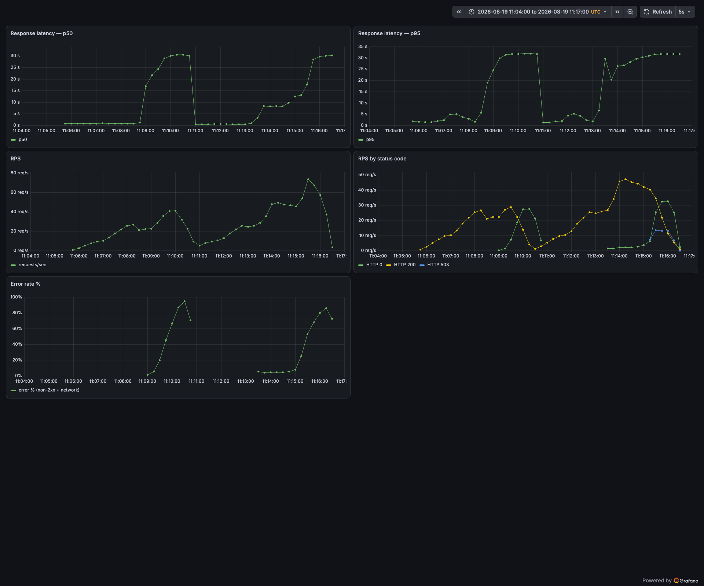
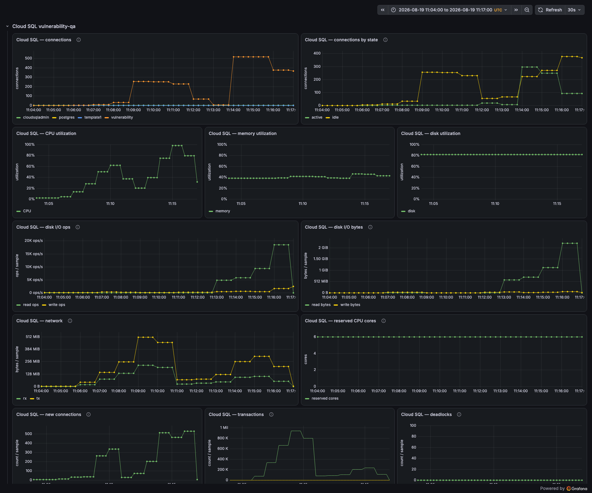
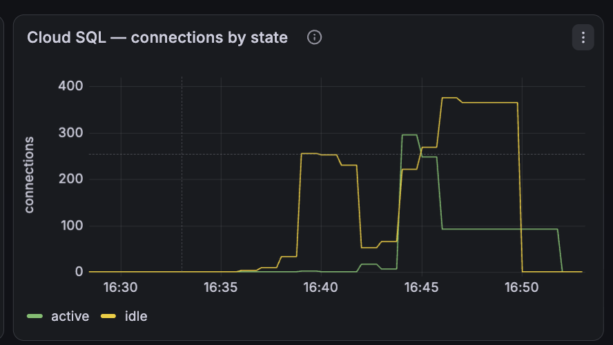

# 2026-08-19 — 2 — include_latest_version · CDS (CVE-only) vs vulnservice (CVE + license + prefetch)

**Flags (both runs):** `PROFILE=batch100` · `batch_size=100` · `skip_cache=true` · **`include_latest_version=true`** (not tested this morning)  
**Shared env:** QA · Cloud SQL **`db-custom-6-32768`** (6 vCPU / 32 GiB, POSTGRES_17, verified)

| | **Run A — CDS** | **Run B — vulnservice** |
|--|-----------------|-------------------------|
| Endpoint | `POST /component-data-service/api/v1/package_info/cached?include_latest_version=true&skip_cache=true` | `POST /vulnservice/api/v1/package_info/cached?include_latest_version=true&skip_cache=true` |
| Window | **11:05:29–11:09:55 UTC** (~4m24s) | **11:10:13–11:15:36 UTC** (~5m22s) |
| Image | `component-data-service:1.2.0` · 4 CPU / 16 GiB | `vulnservice:1.32.0` · 4 CPU / 16 GiB |
| Pool | **`POSTGRES_POOL_MAX_CONNS=256`** (verified) | **`POSTGRES_POOL_MAX_CONNS=512`** (verified) |
| Code on this path | **CVE thin rank + hydrate only** | **CVE thin + license CD index + `prefetchVulnCheckAndMalicious`** |

**What we added (vulnservice only):**

1. Replace the ClearlyDefined `(namespace, name)` index with **`(namespace, name, published_at DESC) INCLUDE (version)`** so latest-version `DISTINCT ON` lookups use the first index entry instead of fetch+sort.
2. Prefetch VulnCheck licenses, malicious packages, GitHub malware, and overrides via **O(1) `unnest` batch queries** (`prefetchVulnCheckAndMalicious`) instead of per-PURL round trips.

**Call-count FYI (app-side, vs the old per-PURL path):** DB calls **went up** — **CVE ~45%**, **license tables ~67%**. Batching fewer round-trip *shapes*, not fewer statements; `include_latest_version` also forces the CD `DISTINCT ON` latest-version lookup that this morning’s runs skipped.

Grafana window for snapshots covers **both** runs (11:04–11:17 UTC).

## Dashboard snapshots







## Capacity (side by side)

| | **CDS (CVE-only)** | **vulnservice (CVE+license+prefetch)** |
|--|-------------------:|---------------------------------------:|
| Abort stage | **50** | **100** |
| Clean 2xx (0% fail) | **~25** | **~25** |
| Mostly 2xx | briefly into **50**, then collapse | through **50**, into early **100** (2xx ~50–61) |
| First HTTP 0 | **50** hold @ **~11:08:44** | **50** hold @ **~11:13:28** |
| Fail at abort | **25.73%** | **25.06%** |
| 5xx at abort | **0.09%** (6) | **6.91%** (777) — late **503s** |
| Requests | 6086 | 11236 |
| Max VUs | 1783 | 2167 |
| End p50 / p95 | 17.8 s / 30 s | 8.7 s / 30 s |
| Clean PURL/s | **~2500** | **~2500** |

### Cliff cheat-sheet

| Question | CDS | vulnservice |
|----------|-----|-------------|
| Till what RPS clean 2xx? | **~25** | **~25** |
| Till what RPS mostly 2xx? | dies on **50** | **~50**, briefly **100** |
| Failure mode | timeouts (~0% 5xx) | timeouts first, then **503s** on pool peg |
| PURL/s at clean band | ~2500 | ~2500 |

## Latency

| Band | CDS p50 → p95 | vulnservice p50 → p95 |
|------|--------------:|----------------------:|
| **10** | ~0.74 → ~1.2–2.2 s | ~0.51 → ~1.1–2.1 s |
| **25** | ~0.72–0.86 → ~1.4–1.9 s | ~0.49–0.59 → ~1.2–1.5 s |
| **50** | **~14–30 → ~18–32 s** (broken) | ~5–11 → ~30 s (soft; 2xx still majority) |
| **100** | — (never held) | **~13–29 → ~30 s** (broken) |

CDS p50 at 10/25 is **~0.72–0.86 s** vs vulnservice **~0.49–0.59 s** — ~**30% cheaper** per request in the healthy band with the license/prefetch work on.

## Stage signals

### CDS (11:05–11:10 UTC)

| Phase | Target | Delivered / 2xx | Fail | p50 → p95 | SQL backends | SQL CPU | CDS CPU | Read |
|-------|-------:|----------------:|------|----------:|-------------:|--------:|--------:|------|
| Hold | **10** | ~10 / ~10 | none | ~0.74 → ~1.2 s | ~4 | ~5% | ~0.3 | **Stable** |
| Hold | **25** | ~24–26 / ~24–26 | none | ~0.72 → ~1.4 s | ~10 | ~14% | ~1.3 | **Stable** |
| Hold | **50** | mix → timeouts | HTTP 0 | **~14–30 → 30 s** | **34 → 256 peg** | **~28–50%** | **~2.6 / 4** | **Broken** |
| Abort | **50** | — | 25.7% fail, 0.09% 5xx | p95 ≈ 30 s | 256 | ~50% | ~2.5 | threshold abort |

### vulnservice (11:10–11:16 UTC)

| Phase | Target | Delivered / 2xx | Fail | p50 → p95 | SQL backends | SQL CPU | Pod CPU | Read |
|-------|-------:|----------------:|------|----------:|-------------:|--------:|--------:|------|
| Hold | **10** | ~10 / ~10 | none | ~0.51 → ~1.1 s | draining CDS leftovers → ~70 | ~20–37% | ~0.3 | **Stable** |
| Hold | **25** | ~23–27 / ~23–27 | none | ~0.49 → ~1.2–1.5 s | ~6–70 | ~20% | ~1.3 | **Stable** |
| Hold | **50** | ~29–61 / ~26–61 | HTTP 0 starts | ~5–11 → ~30 s | **6 → 517 peg** | **~39–75%** | **~2.9 / 4** | **Soft** |
| Hold | **100** | mix → 0 + 503 | timeouts + **503** | **~13–29 → 30 s** | **~517–519** | **~75–98%** | **~3.1 / 4** | **Broken** |
| Abort | **100** | — | 25.1% fail, **6.91%** 5xx | p95 ≈ 30 s | 519 | ~98% | ~3.1 | threshold abort |

### GCP DB (+ app) peaks

| Metric | CDS run | vulnservice run |
|--------|--------:|----------------:|
| SQL CPU | **~50%** (~62% in drain) | **~98%** |
| Backends (`vulnerability`) | **256** (pegged at CDS pool) | **519** (pegged at 512) |
| Backends **active** | not measurable (≤ 256 ceiling; state samples unreliable — see below) | **~296** at the 100 stage |
| SQL memory | ~42% | ~46% |
| Disk reads | near-zero | **~18k ops/s**, **~1.8 GiB/s** at 100 |
| Transactions / sample | **higher** (~1M peak) | **lower** (~250k) — fewer round-trip *batches* |
| App CPU | CDS **~2.6 / 4** (cliff); spike ~4.4 in drain | vulnservice **~3.1 / 4** |
| App memory | CDS **~3.8–6.5 GiB / 16** | vulnservice **~2.6–8.5 GiB / 16** (post-abort spike) |

Fewer Cloud SQL transactions + more connections on vulnservice matches **`unnest` prefetch** (one fat query vs many point lookups). The 100-stage **disk-read spike** is the malware/GitHub joins, not CD `DISTINCT ON`.

### Idle vs active connections

`num_backends_by_state` on `vulnerability`, 60s samples:

| UTC | Stage | active | idle | active+idle | total backends |
|-----|-------|-------:|-----:|------------:|---------------:|
| 11:08 | CDS **50** | 1 | 33 | 34 | 34 |
| 11:09 | CDS **50** (peg) | 2 | **256** | **258** | **256** |
| 11:14 | vuln **100** | **296** | 221 | **517** | **517** |
| 11:15 | vuln **100** | 249 | 269 | 518 | 519 |
| 11:18 | post-run | 92 | 366 | 458 | **0** |

**Trust caveat — do not read the CDS split as “idle-dominated”:**

- `active + idle` **overshoots** `total` in the CDS peg sample (**258 vs 256**), so the two metrics are not sampled at the same instant.
- The by-state series goes **stale**: it repeats `92 / 366` at 11:17–11:19 while `total` has already fallen to **0**.
- CDS `active = 1–2` is **not physically consistent** with SQL CPU **~50%** of 6 vCPU in the same minute. Cloud SQL state sampling is ~60s and lagged; one sample per stage is not enough to characterise a 30–60s cliff.

**What the connection data does support:**

| | CDS | vulnservice |
|--|-----|-------------|
| Pool ceiling | **256** (verified) | **512** (verified) |
| Total backends at cliff | **256** — pegged at the ceiling | **517–519** — pegged |
| Max possible concurrent queries | **≤ 256** by construction | observed **~296 active** |

vulnservice ran **~296 concurrent queries — more in-DB concurrency than CDS's entire pool allows**. That self-consistent sample (`296 + 221 = 517 = total`) matches SQL CPU **~98%**, the disk-read spike, and the higher call counts (CVE +45%, license +67%). The CDS pool ceiling of **256** is a structural limit on how much SQL it can have in flight, which is a separate axis from the timeout cliff. For a real active/idle comparison we need `pg_stat_activity` sampled from the app or DB at ~5s, not Cloud Monitoring's 60s state metric.

## RCA: real bottleneck

### CDS — same HTTP cliff as this morning (CVE-thin, no license opts)

`include_latest_version` did **not** move CDS: still clean **~25**, abort **50**, timeout-only. Pool **256** pegs *after* latency blows (backends **34** when p50 jumps). Insights still **CD `DISTINCT ON` #1 (~33%)** — CDS does not have the new CD index / prefetch.

### vulnservice — license+prefetch buy the 100 stage; then SQL CPU + pool + 503s

Healthy-band p50 is lower than CDS. **50** still mostly 2xx. Collapse is **100**: backends **519**, SQL CPU **~98%**, **6.91%** 5xx (503s). Timeouts still start on **50** (p95 hits 30s) — `cve_query` L2 remains the per-request stretch.

**Call counts went up** (CVE **~45%**, license tables **~67%**) vs the old per-PURL path. That is expected: prefetch issues extra `unnest` statements (licenses + malware + GH + overrides) *and* `include_latest_version` adds the CD latest-version `DISTINCT ON`. Round-trip *count from Go* is higher; **SQL CPU share of CD `DISTINCT ON` is much lower** on vulnservice (~3.8% vs CDS ~33%) because of the covering index.

**Failure chain (vulnservice):**

```text
skip_cache + include_latest_version + batch_size=100
  → CD latest-version DISTINCT ON (index: first entry, no fetch+sort)
  → prefetchVulnCheckAndMalicious: unnest batches (more statements, fewer per-PURL trips)
  → CVE thin rank still ~2 s p90 under concurrency
  → 50: some 30s timeouts, 2xx still majority
  → 100: pool 512 pegs, SQL CPU ~100%, malware joins + disk reads
  → HTTP 0 + 503s → fail > 25% → abort
```

### Query Insights (GCP)

| Rank | **CDS** (11:05–11:10) | **vulnservice** (11:10–11:16) |
|-----:|----------------------|-------------------------------|
| 1 | **~33%** CD `DISTINCT ON` (latest-version) | **~79%** `vulncheck_malicious_packages` ⋈ affected |
| 2 | **~15%** exact CD `(namespace,name,version)` | **~11%** `github_malware_advisories` ⋈ affected |
| 3 | **~9%** vulncheck licenses (**point / per-PURL** shape) | **~3.8%** CD `DISTINCT ON` |
| CVE family | **~20%** thin rank + **~2.6%** hydrate | **~3%** thin rank + **~0.2%** hydrate |
| Overrides | **~4%** point lookups (`namespace = $1`) | batched `unnest` (not in top) |

**Read:** On CDS, `include_latest_version` makes **CD `DISTINCT ON` the #1 SQL hog (~33%)** — the old index / no prefetch. On vulnservice the same query is **~3.8%** (covering index). Prefetch moved VulnCheck/overrides off point lookups; the remaining SQL cliff is **batched malware joins** (~90%) once we actually *reach* 100 RPS.

## Comparison tables

### This pair (same flags, sequential)

| | CDS CVE-only | vulnservice CVE+license+prefetch |
|--|--------------|----------------------------------|
| Abort | **50** | **100** |
| Clean HTTP RPS | ~25 | ~25 |
| Healthy p50 | **~0.75 s** | **~0.50 s** |
| 5xx | ~0% | **6.9%** (pool 512 peg at 100) |
| CD DISTINCT ON Insights | **~33%** | **~3.8%** |
| Malware SQL | ~9% combined | **~90%** (only visible because we survive to 100) |
| Pool | 256 pegged | 512 pegged |
| SQL CPU | ~50% | ~98% |

### vulnservice: morning (no `include_latest_version`) vs this run

Morning: [license opts, skip_cache only](../2026-08-19-package-info-cached-batch100-cve-thin/2026-08-19-package-info-cached-batch100-vulnservice-license/analysis.md) · ~10:32–10:37 UTC.

| | Morning (no latest-version) | This run (`include_latest_version`) |
|--|----------------------------|-------------------------------------|
| Abort | **100** | **100** (unchanged) |
| 5xx | **0.70%** | **6.91%** |
| CD DISTINCT ON Insights | ~3% | ~3.8% (same ballpark — index holds) |
| SQL CPU | ~97–100% | ~98% |
| Takeaway | latest-version **does not move the HTTP cliff**; it **adds 503s** at the 100 peg |

### Amplifiers

1. **`include_latest_version`** — extra CD `DISTINCT ON` per batch (call-count up; CDS pays it in CPU share, vulnservice mostly does not).
2. **DB call count up** — CVE **~45%**, license tables **~67%** vs old per-PURL path.
3. **`skip_cache` + batch 100** — still 100× CVE work per HTTP request.
4. **CDS pool 256** vs vulnservice **512** — CDS cannot show a 100-RPS 503 cliff; it times out first.
5. **Malware `unnest` joins** — SQL CPU / disk once vulnservice reaches 100.

### Not the bottleneck (vulnservice)

- **CD fetch+sort** — covering index; DISTINCT ON share **~3.8%** vs CDS **~33%**.
- **Per-PURL VulnCheck / override round trips** — Insights shows `unnest` on vulnservice, point lookups on CDS.
- **SQL CPU / pool as first fail** — HTTP 0 starts on **50** with backends still climbing.
- **CDS CVE-thin** — necessary but **not sufficient**; same 50 abort as this morning without latest-version.

## Bottom line

**Same flags, two services:** CDS (CVE-only) still dies on **50** with CD `DISTINCT ON` **~33%** of Insights. vulnservice (CVE + covering CD index + prefetch) **holds 50**, **aborts on 100**, healthy p50 **~0.50 s vs ~0.75 s**, and CD latest-version CPU **~33% → ~3.8%**. Call counts are **higher** (CVE +45%, license +67%) by design of prefetch + `include_latest_version`. The remaining cliff is **`cve_query` latency at 50** then **malware-join SQL CPU + pool 512 → 503s at 100**. Next lever is not more pool and not more CD index work — it is CVE ranking time per PURL and the batched malicious-package joins.
