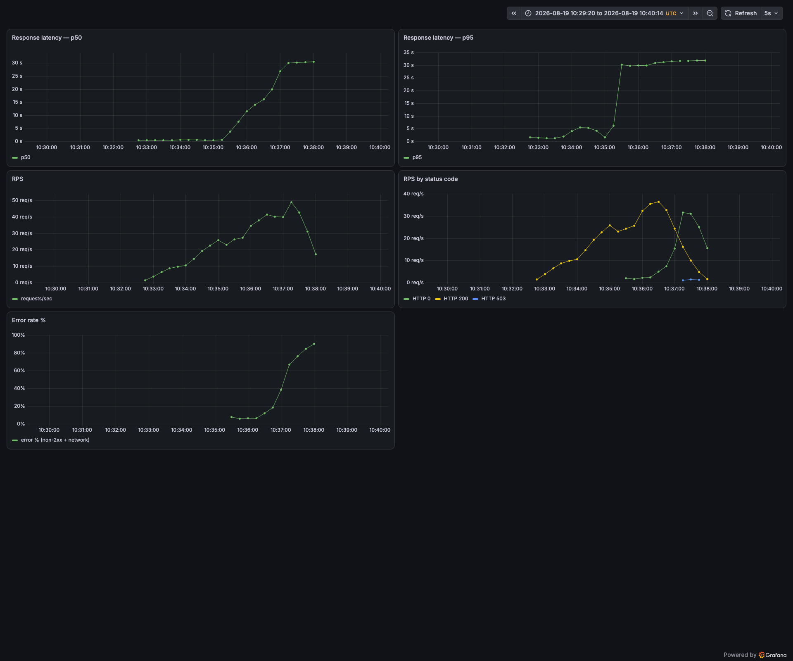
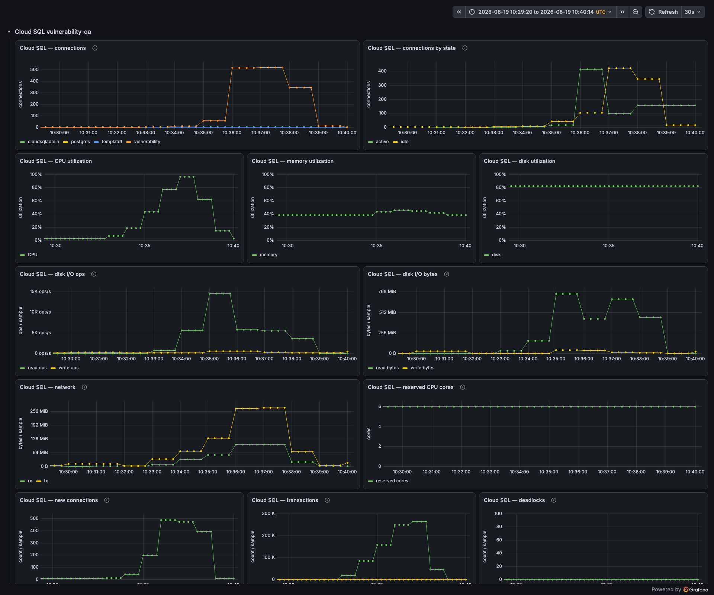
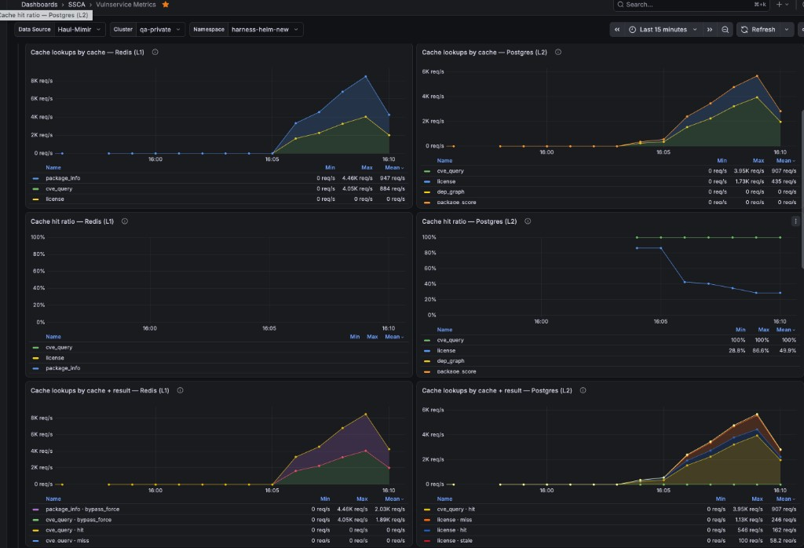
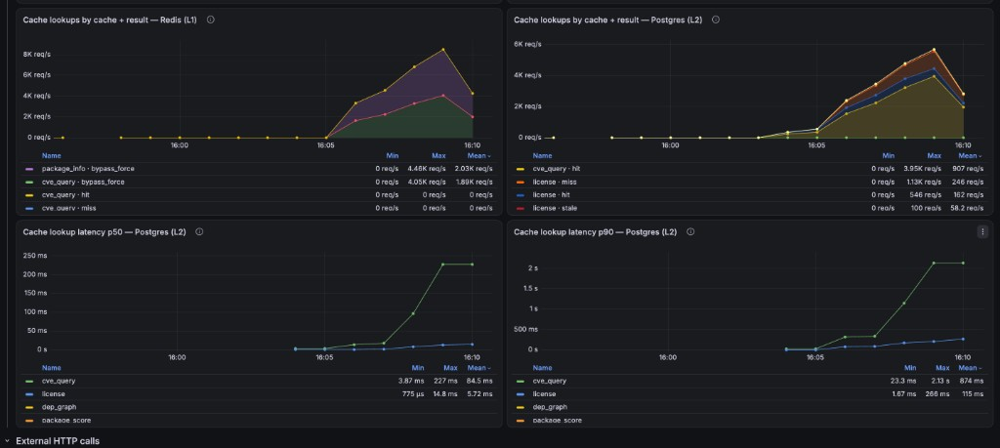

# 2026-08-19 — 2 — vulnservice batch100 · pool 512 · license opts

**Endpoint:** `POST /vulnservice/api/v1/package_info/cached?skip_cache=true`  
**Command:** `API_PATH=/vulnservice/api/v1/package_info/cached PROFILE=batch100 ./run.sh` · **`batch_size=100`** · stages **10 → 25 → 50 → … → 500** (aborted early)  
**Run window:** ~**10:32:20–10:37:14 UTC** (~04m52s; threshold abort)  
**Change under test:** license-query optimisations on vulnservice (plus the earlier thin CVE rank + hydrate already on this image).  
**Env:** QA · 1× **`vulnservice`** (`vulnservice-9cb6b4b65-zd7rd`, image `…/vulnservice:1.32.0`) · limits **4 CPU / 16 GiB** · Cloud SQL **`db-custom-6-32768`** (6 vCPU / 32 GiB, POSTGRES_17, verified) · **`POSTGRES_POOL_MAX_CONNS=512`** (verified via pod env)

> Comparator: [2026-08-17 batch100](../2026-08-17-package-info-cached-batch100/analysis.md) (same **vulnservice** endpoint / flags / profile / pool 512). Same-day CDS CVE-thin run is a different service ([CDS](../2026-08-19-package-info-cached-batch100-cve-thin/analysis.md)).

## Dashboard snapshots









## Capacity

| | Value |
|--|------:|
| Max RPS applied (k6 target before abort) | climbing toward / holding **100** |
| Peak delivered RPS | **~47** (late; mix of 2xx + timeouts) |
| **Clean 2xx (0% fail)** | through **~25** (~25–28 delivered) |
| **Mostly 2xx** | through **~50** (2xx peak **~38–42**) |
| **First timeouts (HTTP 0)** | **50** hold @ **~10:35:30 UTC** |
| Break / abort | under **~100** target at **~25.8%** fail |

At abort: **25.80%** fail · **0.70%** 5xx (56 reqs) · **7894** requests · ~**27.0** delivered RPS avg · max VUs **2291** · **2259** interrupted · **297** dropped iterations · threshold abort (`http_req_failed` `rate<0.25`).

### Cliff cheat-sheet

| Question | Answer |
|----------|--------|
| Till what RPS are we clean 2xx? | **~25 RPS** (0 timeouts / 0 5xx) |
| Till what RPS do we still clear mostly 2xx? | **~50** (2xx ~38–42; some HTTP 0) |
| At what RPS do failures start? | **50** hold (**~10:35:30**) — timeouts begin |
| Where does it collapse? | **100** hold — 2xx falls, HTTP 0 dominates |
| Failure mode | **client 30s timeouts** dominant — **0.70%** 5xx (late 503s) |
| PURL throughput at clean band | **~25 RPS × 100 ≈ 2500 PURLs/s** |
| PURL throughput at mostly-2xx band | **~40 RPS × 100 ≈ 4000 PURLs/s** (not clean) |

## Latency

| Band | Delivered RPS | p50 | p95 |
|------|--------------:|----:|----:|
| Stable | **~10** | **~0.51–0.63 s** | **~1.1–2.1 s** |
| Stable | **~25** | **~0.51–0.82 s** | **~1.2–6 s** (ramp noise, then ~1.2–1.5 s) |
| Soft | **~50** (**10:35:20+**) | **~4–16 s** | **→ ~30 s** |
| Cliff | **~100** | **~16–30 s** | **~30–32 s** |

End-of-run (k6 summary): p50 **13.9 s** (success-only **7.98 s**) · p95 **30 s** (success-only **26.82 s**) · max **30 s** (client timeout).

### Postgres L2 lookup latency (Harness Observability)

Same run window. Redis L1 is **`bypass_force`** for `package_info` + `cve_query` (`skip_cache`); license has **0** L1 lookups.

| Lookup | p50 (peak) | p90 (peak) | Notes |
|--------|----------:|----------:|-------|
| **`cve_query`** | **227 ms** (mean ~85 ms) | **2.13 s** (mean ~874 ms) | Still the slow L2 path |
| **`license`** | **14.8 ms** (mean ~5.7 ms) | **266 ms** (mean ~115 ms) | Fast vs CVE; not the HTTP cliff |

License L2 **hit ratio** starts ~87% then drops to **~29%** at peak (mean ~50%): misses **~1.13k/s**, hits **~546/s**, stale **~100/s**. Cheap per lookup, but more DB round-trips under load.

## When timeouts started (and why)

| Event | UTC | Elapsed | Stage | Signal | Root cause |
|-------|-----|--------:|-------|---------|------------|
| Clean hold | 10:32:50–10:34:50 | — | **10 → 25** | ~10 then ~25 2xx/s; p50 ~0.5–0.8 s | OK |
| VU climb | **10:35:05** | ~2m45s | early **50** | VUs **16 → 255 → 461** | 100-PURL requests slowing |
| **Latency cliff** | **10:35:20** | ~3m | **50** | p50 **~4.2 s**, p95 **~7.7 s** | Queue; backends **~57** |
| **First client timeouts** | **10:35:30** | ~3m10s | **50** | HTTP **0** appears; 2xx still climbing | p95 hits **30s** |
| 50 still useful | **10:36:05–10:36:20** | ~3m45s | **50** | 2xx **~39–42** of ~41–44 | Timeouts present, majority 2xx |
| Pool peg + SQL CPU | **~10:36:20** | ~4m | start **100** | backends **~516**; SQL CPU **~77→100%** | Secondary pile-on |
| Collapse | **10:36:35+** | — | **100** | 2xx **28 → 15**; VUs **→2291** | Timeouts dominate |
| Abort | **~10:37:14** | ~4m52s | **100** | fail **25.8%**; **0.70%** 5xx | threshold abort |

**Read:** Unlike Aug 17 batch100, **50 RPS still returns mostly 2xx** (peak ~38–42). First timeouts still start on **50**, but the run **survives that hold** and dies on **100**, where SQL CPU hits **~100%** and the **512** pool pegs.

## Stage signals (Prometheus + GCP)

| Phase | Target | Delivered / 2xx | Fail mode | p50 → p95 | SQL backends | SQL CPU | Pod CPU | Read |
|-------|-------:|----------------:|-----------|----------:|-------------:|--------:|--------:|------|
| Hold | **10** | ~10 / ~10 | none | ~0.52 → ~1.1–2.1 s | ~4 | ~7% | ~0.16 | **Stable** |
| Hold | **25** | ~23–26 / ~23–26 | none | ~0.51 → ~1.2–1.5 s | ~10 | ~19% | ~0.81 | **Stable** |
| Hold | **50** | ~33–44 / ~29–42 | **HTTP 0** starts | **~4–16 → ~8–30 s** | **57 → 516** | **43→77%** | **1.6→3.2** | **Soft** |
| Hold | **100** | mix → timeouts | **HTTP 0** + late 503 | **~16–30 → ~30 s** | **~516–517** | **~77–100%** | **~3.2 / 4** | **Broken** |
| Abort | **100** | — | **25.8%** fail, **0.70%** 5xx | p95 ≈ **30 s** | ~517 | ~97–100% | ~3.0 | threshold abort |

### GCP DB (+ app) peaks

| Metric | Peak |
|--------|-----:|
| Cloud SQL tier | **`db-custom-6-32768`** (verified) |
| Cloud SQL CPU | **~97–100%** of 6 vCPU |
| Cloud SQL backends (`vulnerability`) | **~517** (**pegged** at pool 512 + extras) |
| Cloud SQL memory | ~**46%** |
| Disk read ops | **~14k/s** (read-heavy; writes ~0) |
| vulnservice pod CPU (primary) | **~3.17 / 4** cores |
| vulnservice pod memory | **~4.7 GiB / 16 GiB** |
| Pool config | **`POSTGRES_POOL_MAX_CONNS=512`** (verified via pod env) |

## RCA: real bottleneck

### Primary: **`cve_query` Postgres L2 latency under batch-100, then SQL CPU + pool peg on the 100 stage**

At first timeouts (**10:35:30**), backends are **~57** (not 512), SQL CPU **~43%**, pod CPU **~1.6/4**. Decision tree: **not** pool or SQL-CPU primary at first fail.

On the **100** stage those headroom metrics disappear: SQL CPU **~100%**, backends **~517**, pod CPU **~3.2/4**, plus **0.70%** 5xx (503s).

Harness Observability (same window):

| Postgres L2 lookup | During cliff | vs others |
|--------------------|-------------:|-----------|
| **`cve_query` p50 / p90** | **227 ms / 2.13 s** | still the spike |
| **`license` p50 / p90** | **14.8 ms / 266 ms** | ~15× cheaper at p50 |
| Redis L1 | `package_info` + `cve_query` **`bypass_force`** (~4.5k + ~4.1k/s) | expected with `skip_cache` |
| License L1 | **0 req/s** | never on Redis |
| License L2 hit ratio | **~87% → 29%** | more misses, still fast |

License opts **did not become the HTTP cliff**. CVE L2 p50 improved vs Aug 17 (**625 ms → 227 ms**); p90 is similar (**~2.5 s → 2.13 s**). That is enough to **hold 50 with mostly 2xx**, not enough to keep p95 under 30s once arrival rate hits **100**.

| Signal at first timeouts (~10:35:30) | Observation | Meaning |
|-------------------------------------|-------------|---------|
| App `cve_query` Postgres p90 | **~2.13 s** | **Primary latency driver** on L2 path |
| App `license` Postgres p50 | **~15 ms** | Licence path is not stretching the request |
| Cloud SQL backends | **~57** | Not pegged yet |
| Cloud SQL CPU | **~43%** | Headroom at first fail |
| Pod CPU | **~1.6 / 4** | Not at limit |
| 5xx / 503 | later **0.70%** | Pool-exhaust 503s only after peg |
| Client timeouts | **dominant fail mode** | Primary symptom |

**Failure chain:**

```text
skip_cache + batch_size=100
  → Redis L1 bypass_force (package_info + cve_query); license never on L1
  → every PURL hits Postgres; license L2 stays ~15 ms p50
  → cve_query L2 p50→227 ms, p90→2.13 s (improved vs Aug 17, still slow)
  → 100 PURLs/request × CVE lookups → multi-second HTTP latency at 50
  → VUs climb; some 30s timeouts on 50, but 2xx still ~38–42
  → 100 RPS: backends peg ~512, SQL CPU ~100%, disk reads ~14k/s
  → p50/p95 → 30s; HTTP 0 dominates; late 503s (0.70% 5xx)
  → http_req_failed > 25% → k6 abortOnFail
```

### Query Insights (GCP)

Window **10:31–10:39 UTC** ([console](https://console.cloud.google.com/sql/instances/vulnerability-qa/insights?project=qa-setup)):

| Rank | Share of query CPU | Query |
|-----:|-------------------:|-------|
| 1 | **~79%** | `vulncheck_malicious_packages` ⋈ `…_affected` |
| 2 | **~11%** | `github_malware_advisories` ⋈ `…_affected` |
| 3 | **~3.2%** | `clearly_defined_licenses` `DISTINCT ON (namespace, name)` via `unnest` |
| 4+7+8 | **~3.7%** | **thin** `product_cves ⋈ cves` + `dense_rank()` (no `nvd` in rank) |
| 5 | **~1.3%** | `vulncheck_licenses` point lookups |
| 6 | **~1.0%** | exact `clearly_defined_licenses` `(namespace, name, version)` |
| 9 | **~0.24%** | hydrate `SELECT internal_id, provider, nvd FROM cves WHERE (internal_id, provider) IN (unnest…)` |

**Read:** License SQL is **cheap now** — CD DISTINCT ON dropped from **~38% (Aug 17)** to **~3%**. Combined license-family share is **~5–6%**. CVE family is **~4%** (+ hydrate). **~90% of Insights CPU is malware-package joins** (vulncheck + GitHub). That matches the **read-heavy disk I/O** and **SQL CPU ~100%** on the 100 stage. App request time is still gated by **`cve_query` L2 p90 ~2 s**, not license.

### Amplifiers

1. **`skip_cache`** — Redis `bypass_force`; full Postgres fan-out.
2. **`batch_size=100`** — 100× CVE/license/malware work per HTTP request.
3. **`cve_query` Postgres L2 p90 ~2.13 s** — still stretches each request.
4. **Malware-package SQL (~90% Insights)** — drives SQL CPU / disk reads at the 100 stage.
5. **Pool 512 peg (late)** — 503s appear after the latency cliff.
6. **Pod CPU ~3.2/4** — amplifier once backlog exists.
7. **k6 30s timeout** — turns multi-second queueing into hard fails.

### Not the bottleneck

- **License L2 latency** — p50 **~15 ms**, p90 **~266 ms** vs CVE p90 **~2.1 s**.
- **License Redis** — unused by design (0 L1 lookups).
- **Cloud SQL memory** — ~46%.
- **Pod memory** — ~4.7 / 16 GiB.
- **Pool peg as first cause** — backends **~57** when HTTP 0 starts.
- **SQL CPU as first cause** — **~43%** at first timeouts (hits **~100%** later on 100).

## Comparison vs Aug 17 vulnservice batch100

Comparator: [2026-08-17 batch100](../2026-08-17-package-info-cached-batch100/analysis.md) (same endpoint, `db-custom-6-32768`, pool **512**).

| | **Aug 17 batch100** | **Aug 19 license opts (this run)** |
|--|---------------------|-------------------------------------|
| SQL tier / pool | `db-custom-6-32768` / **512** | same (verified) |
| App | vulnservice / 4 CPU / 16 GiB | **vulnservice:1.32.0** / same limits |
| Profile / flags | `batch100`, `skip_cache` | same |
| Clean HTTP RPS (0% fail) | **~25** | **~25** (unchanged) |
| Mostly-2xx HTTP RPS | collapses on early **50** | **~50** holds (~38–42 2xx) |
| Abort stage | **50** | **100** |
| Clean **PURL/s** | **~2500** | **~2500** |
| First failure | timeouts on early **50** | timeouts on **50**, collapse on **100** |
| 5xx at cliff | **0%** | **0.70%** (late 503s) |
| Backends at abort | **~441** (not pegged) | **~517** (pegged) |
| SQL CPU peak | **~58%** | **~97–100%** |
| App CPU peak | **~3.2 / 4** | **~3.2 / 4** |
| `cve_query` L2 p50 / p90 | **~625 ms / ~2.5 s** | **~227 ms / ~2.13 s** |
| `license` L2 p50 / p90 | **~8 ms / ~161 ms** | **~15 ms / ~266 ms** |
| CD DISTINCT ON Insights | **~38%** | **~3%** |
| CVE family Insights | **~36%** | **~4%** |
| Malware joins Insights | not in top | **~90%** |
| Primary bottleneck | CVE latency → timeouts | **CVE latency first; SQL CPU + pool on 100** |

**Takeaways**

1. **License SQL optimisation landed** — CD DISTINCT ON is no longer the Insights #1 (~38% → ~3%); license L2 stays **~15 ms** p50.
2. **HTTP cliff moved one stage** — still clean at **~25**, but **50 is mostly 2xx** now; abort is **100**, not **50**.
3. **CVE L2 p50 roughly 2.7× better** (625 → 227 ms); p90 still ~2 s, so batch-100 still times out once concurrency jumps.
4. **New SQL hog:** vulncheck + GitHub **malicious package** joins (~90% Insights) + SQL CPU **~100%** + **14k** read ops/s at the 100 stage.
5. Pool **does** peg this time (we reached 100 RPS); 503s stay a **small** share vs timeouts.

### Bottom line

**Healthy at ~25 RPS with 100 PURLs/POST (~2500 PURLs/s). Useful (not clean) through ~50 RPS (~4000 PURLs/s).** Breaks on the **100** stage with **timeout-dominant** failures, then SQL CPU **~100%** and pool **512** peg. License lookups are **not** the cliff (p50 ~15 ms); **`cve_query` L2 p90 ~2.1 s** still stretches each batch-100 request. Next levers: cut **CVE ranking time per PURL**, and the **malicious-package joins** that now dominate Query Insights / SQL CPU — raising pool alone will not restore a clean 100 RPS.
