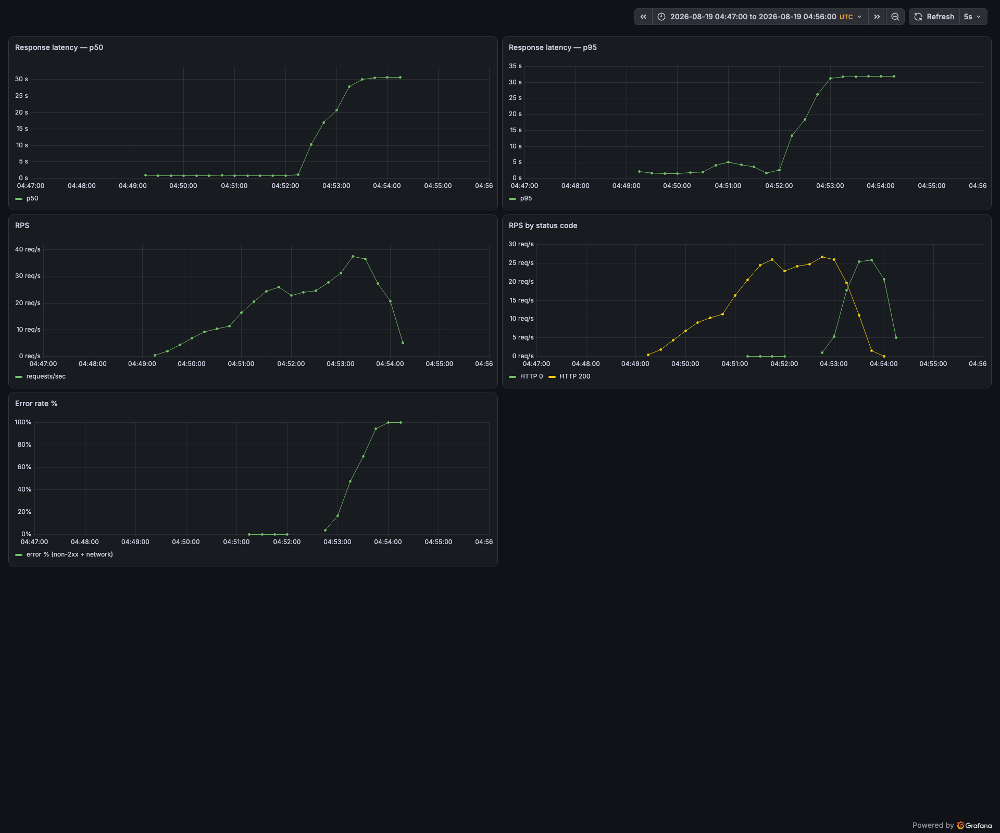
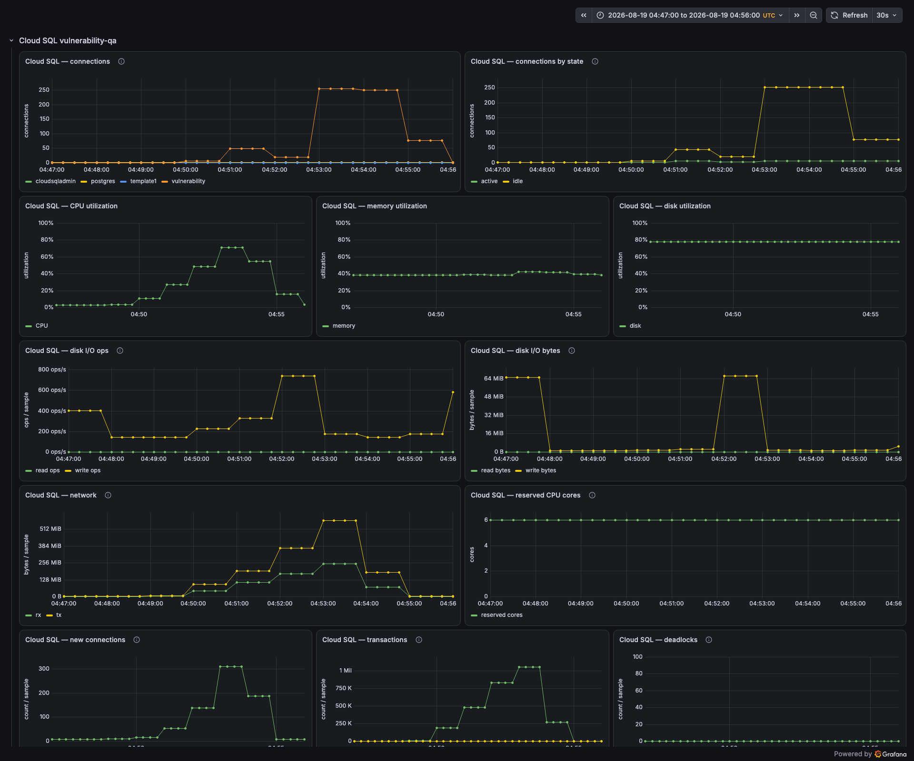

# 2026-08-19 — 1 — CDS batch100 · pool 256 · CVE thin + hydrate

**Endpoint:** `POST /component-data-service/api/v1/package_info/cached?skip_cache=true`  
**Command:** `PROFILE=batch100 ./run.sh` · **`batch_size=100`** · stages **10 → 25 → 50 → … → 500** (aborted early)  
**Run window:** ~**04:49:05–04:53:23 UTC** (~04m18s; threshold abort)  
**Change under test:** CVE path — thin `product_cves ⋈ cves` join/rank (columns: `created_at`, `updated_at`, `provider`, `id`, `internal_id` + product_cves fields + `provider_priority`; **no `nvd`**); drop redundant CTE `ORDER BY`; after version-match / priority-1 filter, **`hydrateCVEAndVersionsNVD`** loads `nvd` for survivor `(internal_id, provider)` pairs via `unnest` (unconditional for every caller).  
**Env:** QA · 1× **`component-data-service`** (`component-data-service-6d44545cb9-ld84g`, image `…/component-data-service:1.2.0`) · limits **4 CPU / 16 GiB** · Cloud SQL **`db-custom-6-32768`** (6 vCPU / 32 GiB, POSTGRES_17, verified) · **`POSTGRES_POOL_MAX_CONNS=256`** (verified via CDS configmap)

> Comparator: [2026-08-17 batch100](../2026-08-17-package-info-cached-batch100/analysis.md) (same endpoint/flags/profile). That doc labeled app metrics as vulnservice; this run attributes app CPU/mem/pool to **component-data-service**.

## Dashboard snapshots





## Capacity

| | Value |
|--|------:|
| Max RPS applied (k6 target before abort) | climbing toward / holding **50** |
| Peak delivered RPS | **~40–50** (late; mostly timeouts) |
| **Clean 2xx (0% fail)** | through **~25** (~25–28 delivered) |
| **First timeouts (HTTP 0)** | early **50** hold @ **~04:52:45 UTC** |
| Break / abort | under **~50** target at **~25.2%** fail |

At abort: **25.19%** fail · **0.12%** 5xx (7 reqs) · **5791** requests · ~**22.5** delivered RPS avg · max VUs **1658** · **1670** interrupted · threshold abort (`http_req_failed` `rate<0.25`).

### Cliff cheat-sheet

| Question | Answer |
|----------|--------|
| Till what RPS are we clean 2xx? | **~25 RPS** (0 timeouts / ~0 5xx) |
| Till what RPS do we still clear mostly 2xx? | briefly into **50**, then collapses |
| At what RPS do failures start? | early **50** hold (**~04:52:45**) |
| Failure mode | **client 30s timeouts** dominant — **~0%** 5xx |
| PURL throughput at clean band | **~25 RPS × 100 ≈ 2500 PURLs/s** |

## Latency

| Band | Delivered RPS | p50 | p95 |
|------|--------------:|----:|----:|
| Stable | **~10** | **~0.75–0.85 s** | **~1.4–2.4 s** |
| Stable | **~25** | **~0.73–0.83 s** | **~1.2–2.6 s** (after ramp) |
| Cliff | early **~50** (**04:52:10+**) | → **~9–30 s** | → **~12–32 s** |

End-of-run (k6 summary): p50 **10.25 s** (success-only **1.14 s**) · p95 **30 s** (success-only **23.83 s**) · max **30 s** (client timeout).

## When timeouts started (and why)

| Event | UTC | Elapsed | Stage | Signal | Root cause |
|-------|-----|--------:|-------|---------|------------|
| Clean hold | 04:49:20–04:51:45 | — | **10 → 25** | ~10 then ~25–28 2xx/s; p50 ~0.75 s | OK |
| VU explosion | **04:52:00** | ~3m | early **50** | VUs **44 → 361 → 798**; backends still **~20** | Each 100-PURL request slow → Little’s law |
| **Latency cliff** | **04:52:10** | ~3m05s | **50** | p50 **~8.7 s**, p95 **~11.6 s** | In-flight queue; pool **not** pegged yet |
| **First client timeouts** | **04:52:45** | ~3m40s | **50** | HTTP **0** appears; 2xx collapses | p95 hits k6 **30s** timeout |
| Pool peg | **~04:53:00** | ~3m55s | **50** | backends **→ 256** (= pool max) | Secondary; after latency already blown |
| Abort | **~04:53:23** | ~4m18s | **50** | fail **25.2%**; **0.12%** 5xx | threshold abort |

**Read:** Same shape as Aug 17 batch100 — **timeout-only** cliff on the way to **50 RPS**. Latency / VU blow-up starts while backends are still low (**~20**); the **256** pool peg arrives **after** the cliff. Thin CVE + hydrate did **not** move the healthy HTTP RPS band.

## Stage signals (Prometheus + GCP)

| Phase | Target | Delivered / 2xx | Fail mode | p50 → p95 | SQL backends | SQL CPU | CDS CPU | Read |
|-------|-------:|----------------:|-----------|----------:|-------------:|--------:|--------:|------|
| Hold | **10** | ~10 / ~10 | none | ~0.75 → ~1.4–2.4 s | ~6 | ~10% | ~0.3–0.5 | **Stable** |
| Hold | **25** | ~25–28 / ~25–28 | none | ~0.73 → ~1.2–2.6 s | ~49 | ~27% | ~1.2–1.8 | **Stable** |
| Hold | **50** | mix → timeouts | **HTTP 0** | **~9–30 → ~12–32 s** | **20 → 256** | → **~71%** | → **~3.9 / 4** | **Broken** |
| Abort | **50** | — | **25.2%** fail, **0.12%** 5xx | p95 ≈ **30 s** | ~250–256 | ~55–71% | ~3.0–3.9 | threshold abort |

### GCP DB (+ CDS app) peaks

| Metric | Peak |
|--------|-----:|
| Cloud SQL tier | **`db-custom-6-32768`** (verified) |
| Cloud SQL CPU | **~71%** of 6 vCPU |
| Cloud SQL backends (`vulnerability`) | **~256** (**pegged** at CDS pool max) |
| Cloud SQL memory | ~**42%** |
| CDS pod CPU (primary) | **~3.9 / 4** cores |
| CDS pod memory | **~2.0 GiB / 16 GiB** |
| Pool config | **`POSTGRES_POOL_MAX_CONNS=256`** (verified via `component-data-service` configmap) |

## RCA: real bottleneck

### Primary: **batch-100 per-request work still stretches latency → VU blow-up → 30s timeouts**

At first timeouts (**04:52:45**), backends are rising from **~20** (not yet 256), SQL CPU **~49–71%**, CDS CPU climbing toward **~3.9/4**. Decision tree: **not** “pool primary at first fail,” even though the pool **does** peg moments later.

Query Insights confirms the new CVE shape is live (thin join/rank + hydrate), and CVE’s share of SQL CPU is **lower** than Aug 17 — but the **HTTP cliff is unchanged** (~25 clean → break at 50).

| Signal at first timeouts (~04:52:45) | Observation | Meaning |
|-------------------------------------|-------------|---------|
| Cloud SQL backends | **~20 → climbing** | Not pegged yet when cliff starts |
| Cloud SQL CPU | **~49–71%** | Headroom; not SQL-CPU saturation |
| CDS pod CPU | → **~3.9 / 4** | Near limit — strong amplifier once backlog exists |
| 5xx / 503 | **0.12%** (7 reqs) | Not the pool-exhaust 503 path |
| Client timeouts | **dominant fail mode** | Primary symptom |
| Pool peg @ 256 | **~04:53:00** (after cliff) | Secondary pile-on |

**Failure chain:**

```text
skip_cache + batch_size=100
  → Redis bypassed; every PURL hits Postgres (license + thin CVE rank + hydrate survivors)
  → per HTTP request still multi-second under rising concurrency
  → VUs explode (Little’s law) to hold arrival rate toward 50 RPS
  → in-flight queue → p50/p95 → 30s
  → client timeouts (HTTP 0); rare 5xx
  → backends later peg at 256 (CDS pool) — after the latency cliff
  → http_req_failed > 25% → k6 abortOnFail
```

### Query Insights (GCP)

Window **04:48–04:55 UTC** ([console](https://console.cloud.google.com/sql/instances/vulnerability-qa/insights?project=qa-setup)):

| Rank | Share of query CPU | Query |
|-----:|-------------------:|-------|
| 1 | **~44%** | `clearly_defined_licenses` `DISTINCT ON (namespace, name)` via `unnest` |
| 2 | **~14%** | exact `clearly_defined_licenses` `(namespace, name, version)` via `unnest` |
| 3 | **~7.5%** | `vulncheck_licenses` point lookups |
| 4–7 (combined) | **~16.8%** | **thin** `product_cves ⋈ cves` + `dense_rank()` (selected cols only — **no `cves.*` / no `nvd`**) |
| 11 | **~2.0%** | **hydrate** `SELECT internal_id, provider, nvd FROM cves WHERE (internal_id, provider) IN (unnest…)` |
| — | ~5%+ | other license / advisory lookups |

**Read:** The optimisation is visible in Insights (thin rank + separate hydrate). Combined CVE-related SQL CPU is **~19%** vs Aug 17’s **~36%** CVE family — a real SQL-CPU win. **CD DISTINCT ON remains #1 (~44%)**. App/HTTP cliff did not move with this change alone.

### Amplifiers

1. **`skip_cache`** — full Postgres fan-out every PURL.
2. **`batch_size=100`** — 100× CVE/license/hydrate work per HTTP request.
3. **CDS CPU ~3.9/4** — near limit at cliff (Go filter + hydrate + JSON).
4. **CD DISTINCT ON** — top Insights CPU share (~44%).
5. **Pool 256 peg (late)** — secondary; arrives after latency cliff.
6. **Single CDS pod** — one pool → one DB.
7. **k6 30s timeout** — turns multi-second queueing into hard fails.

### Not the bottleneck

- **Cloud SQL CPU saturation** — peak **~71%**, not ~100%.
- **5xx/503 path** — **0.12%** 5xx entire run.
- **CDS memory** — ~2 GiB / 16 GiB.
- **Redis** — bypassed by design (`skip_cache`).
- **Pool peg as first cause** — backends ~20 when latency already multi-second.

## Comparison vs Aug 17 batch100

Comparator: [2026-08-17 batch100](../2026-08-17-package-info-cached-batch100/analysis.md) (pre thin-CVE/hydrate).

| | **Aug 17 batch100** | **Aug 19 CVE-thin (this run)** |
|--|---------------------|--------------------------------|
| SQL tier | `db-custom-6-32768` | same (verified) |
| App | documented as vulnservice / pool **512** | **`component-data-service`** / pool **256** (verified) |
| Profile / flags | `batch100`, `skip_cache` | same |
| CVE SQL shape | fat join (`cves.*` / nvd in rank) | **thin rank + hydrate nvd** |
| Clean HTTP RPS (0% fail) | **~25** | **~25** (unchanged) |
| Clean **PURL/s** | **~2500** | **~2500** |
| First failure | timeouts on early **50** | timeouts on early **50** |
| 5xx at cliff | **0%** | **0.12%** |
| Backends at cliff | **~441** (under 512) | **→ 256 pegged** (late) |
| SQL CPU peak | **~58%** | **~71%** |
| App CPU peak | **~3.2 / 4** (as labeled) | **CDS ~3.9 / 4** |
| CVE family Insights share | **~36%** | **~17% thin + ~2% hydrate ≈ 19%** |
| CD DISTINCT ON share | **~38%** | **~44%** |
| Primary bottleneck | CVE latency → timeouts | **same HTTP cliff**; SQL CVE cheaper but not enough |
| Abort | ~25.7% fail under ~50 | ~25.2% fail under ~50 |

**Takeaways**

1. **Thin CVE + hydrate landed** — Insights shows selected-column rank queries and the `nvd` unnest hydrate (~2% CPU).
2. **HTTP capacity did not move** — still healthy at **~25 RPS / ~2500 PURLs/s**, still dies on early **50** with **timeouts**.
3. **CVE SQL CPU share roughly halved** (~36% → ~19%), so CD / app CPU / remaining per-PURL work now dominate the leftover budget.
4. **Pool is 256 on CDS** and pegs late; raising pool alone still won’t fix the timeout shape (cliff starts with backends ~20).

### Bottom line

**Healthy at ~25 RPS with 100 PURLs/POST (~2500 PURLs/s) — same as Aug 17.** Breaks on the ramp/hold to **50 RPS** with **timeout-only** failures. The CVE thin-join + survivor hydrate is live and cuts CVE’s Query Insights share, but **does not raise the batch-100 cliff**. Next levers: CD `DISTINCT ON` (still #1 SQL CPU), cut remaining per-PURL work / CDS CPU (~3.9/4 at cliff), or accept ~25 RPS as the `skip_cache` batch-100 ceiling on this env.
